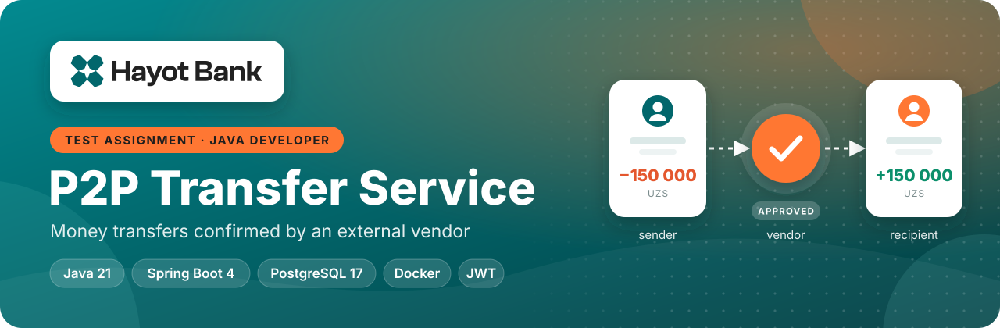
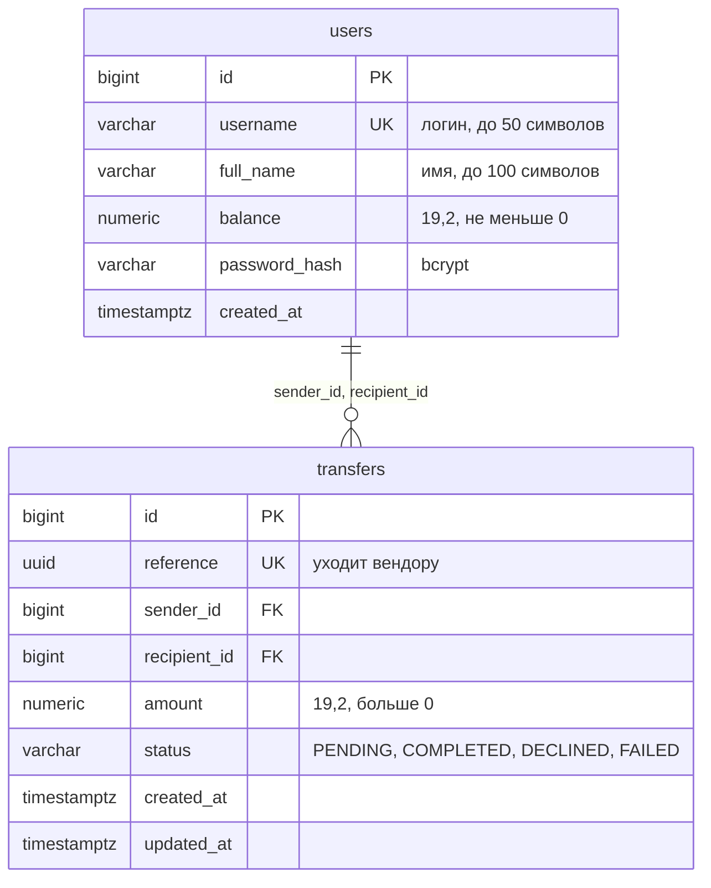
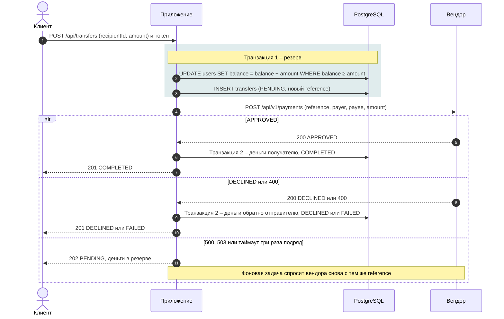
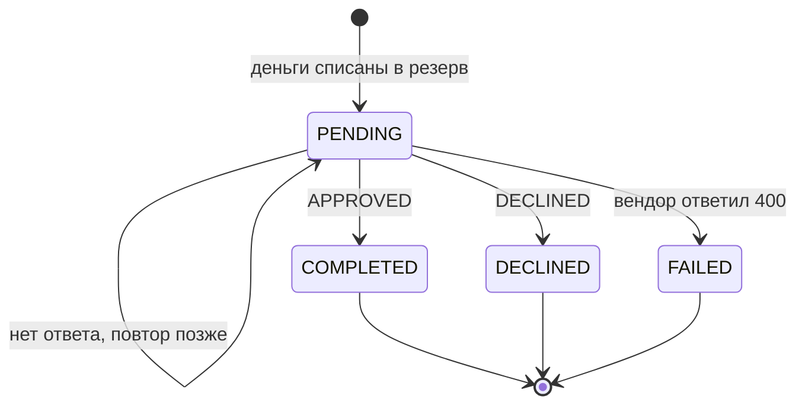
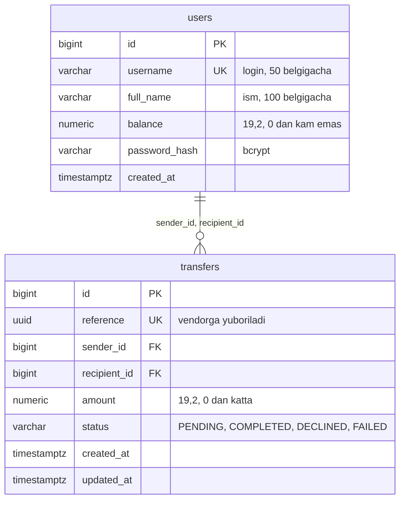
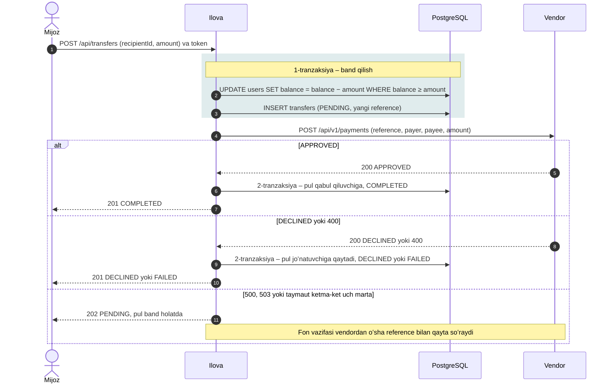
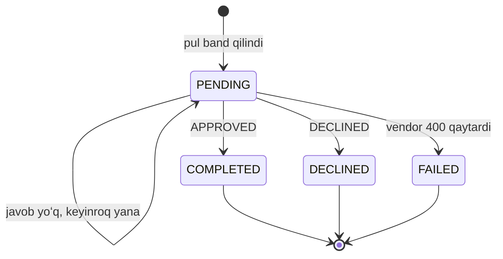
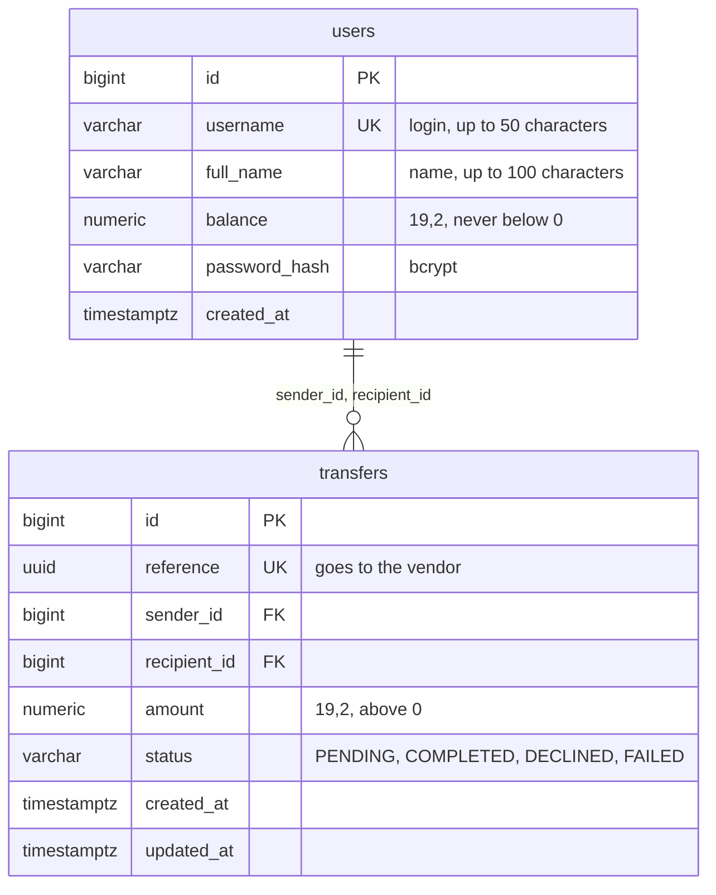
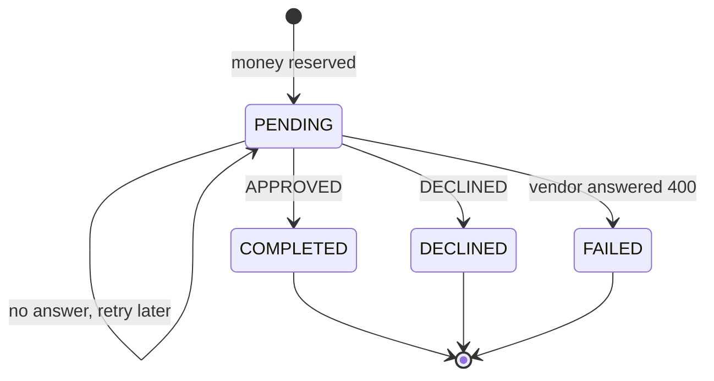

<a id="top" name="top"></a>

<div align="center">



<br><br>

[](https://github.com/divergenny/vendor-confirmed-p2p-transfer-service/actions/workflows/ci.yml)  


<br>


<br>

**Тестовое задание для собеседования на позицию Java-разработчика в Hayot Bank**<br>
<sub>Hayot Bank’da Java-dasturchi lavozimi uchun suhbat test topshirigʻi</sub><br>
<sub>Interview test assignment for the Java Developer position at Hayot Bank</sub>

<br>

### [ Русский](#ru) &nbsp;·&nbsp; [ Oʻzbekcha](#uz) &nbsp;·&nbsp; [ English](#en)

</div>

<br>

> [!NOTE]
>  REST API для переводов денег между пользователями. Каждый перевод подтверждает внешняя система вендора: деньги сначала резервируются у отправителя и уходят получателю, только когда вендор ответил «да».
>
>  Foydalanuvchilar oʻrtasida pul oʻtkazmalari uchun REST API. Har bir oʻtkazmani tashqi vendor tizimi tasdiqlaydi: pul avval joʻnatuvchida band qilinadi va faqat vendor «ha» deb javob bergandan keyin qabul qiluvchiga oʻtadi.
>
>  A REST API for money transfers between users. Every transfer is confirmed by an external vendor: the money is reserved on the sender's side first and reaches the recipient only after the vendor says "yes".

<details>
<summary><b>📄 Тестовое задание</b></summary>

<br>

> **Тестовое задание: Java-разработчик**
>
> Разработайте REST API для переводов денег между пользователями.
>
> **Описание**
>
> В системе есть пользователи, у каждого пользователя есть баланс. Пользователь может перевести деньги другому пользователю.
>
> Каждый перевод должна подтвердить внешняя система вендора. Перевод проводится, только если вендор его подтвердил.
>
> Пополнение баланса в задание не входит: начальные балансы задайте тестовыми данными.
>
> **Что нужно сделать**
>
> 1. **Таблицы БД** для пользователей и переводов. Структуру определите сами. Заполните таблицы тестовыми данными.
> 2. **REST API** с методами из таблицы ниже.
> 3. **Интеграция с вендором** по контракту ниже.
>
> **Методы API**
>
> | Метод | Путь | Назначение |
> |-------|------|------------|
> | POST | /api/users | Создать пользователя |
> | GET | /api/users/{id} | Получить пользователя и его баланс |
> | POST | /api/transfers | Перевести деньги другому пользователю |
> | GET | /api/transfers/{id} | Получить перевод |
> | GET | /api/users/{id}/history | История операций пользователя за интервал дат, с пагинацией |
>
> Формат запросов и ответов определите сами.
>
> **API вендора**
>
> Вендор – внешний HTTP-сервис. Его адрес задаётся в конфигурации приложения.
>
> **Подтвердить перевод:** POST /api/v1/payments
>
> ```json
> {
>   "reference": "7f3c9a2e-5b1d-4e8a-9c6f-2d4b8e1a0f35",
>   "payer": "101",
>   "payee": "102",
>   "amount": 150000.00
> }
> ```
>
> - reference – уникальный идентификатор перевода в вашей системе. Повторный запрос с тем же reference не создаёт новую операцию: вендор возвращает результат первого запроса.
> - payer, payee – идентификаторы отправителя и получателя в вашей системе.
>
> Ответ 200 OK:
>
> ```json
> {
>   "reference": "7f3c9a2e-5b1d-4e8a-9c6f-2d4b8e1a0f35",
>   "status": "APPROVED"
> }
> ```
>
> status: APPROVED – перевод подтверждён, DECLINED – отклонён.
>
> **Ошибки и время ответа:**
>
> - 400 – некорректный запрос;
> - 500, 503 – временная ошибка на стороне вендора;
> - время ответа – до 10 секунд.
>
> **Требования**
>
> - Java 17+, Spring Boot, Maven.
> - PostgreSQL. Схема БД создаётся миграциями (Liquibase или Flyway).
> - Валидация входных данных и обработка ошибок. Ошибки возвращаются в едином формате с корректными HTTP-статусами (400, 404 и т.д.).
> - Тесты:
>   - unit-тесты бизнес-логики;
>   - интеграционные тесты API на реальной PostgreSQL (Testcontainers), вендор подменяется HTTP-заглушкой (WireMock или MockServer).
> - Dockerfile с multi-stage сборкой: проект собирается внутри Docker-образа. docker-compose.yml одной командой поднимает приложение, PostgreSQL и заглушку вендора.
>
> **Будет плюсом**
>
> - Аутентификация через JWT.
> - OpenAPI/Swagger-спецификация.
>
> **Как сдать**
>
> Пришлите ссылку на публичный Git-репозиторий. В README.md укажите:
>
> - как запустить проект и тесты;
> - описание эндпоинтов с примерами запросов;
> - структуру таблиц БД;
> - как устроено проведение перевода и взаимодействие с вендором.

</details>

<br>

---

<a id="ru" name="ru"></a>

##  Описание решения

**Содержание**

- [✅ Что сделано по заданию](#ru-done)
- [🧰 Стек](#ru-stack)
- [🚀 Как запустить проект](#ru-run)
- [🧪 Как запустить тесты](#ru-tests)
- [📡 Эндпоинты и примеры запросов](#ru-api)
- [🗄️ Структура таблиц БД](#ru-db)
- [💸 Как проводится перевод](#ru-transfer)
- [🔌 Взаимодействие с вендором](#ru-vendor)
- [🔐 Аутентификация (JWT)](#ru-auth)
- [⚙️ Настройки](#ru-config)
- [🗂️ Структура проекта](#ru-structure)
- [🧭 Как шла работа](#ru-history)

<a id="ru-done" name="ru-done"></a>

### ✅ Что сделано по заданию

| | Требование | Как сделано |
|:-:|---|---|
| ✅ | Таблицы БД для пользователей и переводов, тестовые данные | таблицы `users` и `transfers`, миграции Liquibase; 4 тестовых пользователя и 3 перевода |
| ✅ | REST API: 5 методов из задания | все 5 методов + вход `POST /api/auth/login` |
| ✅ | Интеграция с вендором по контракту | `VendorClient`: таймауты, повторы, один `reference` на все попытки |
| ✅ | Java 17+, Spring Boot, Maven | Java 21, Spring Boot 4.1.2, Maven Wrapper |
| ✅ | PostgreSQL, схема через миграции | PostgreSQL 17, Liquibase 5 (changelog в YAML) |
| ✅ | Валидация, единый формат ошибок, правильные HTTP-статусы | Bean Validation и RFC 9457 Problem Details: 400, 401, 403, 404, 409, 422 |
| ✅ | Unit-тесты бизнес-логики | JUnit 6 + Mockito: переводы, пользователи, история |
| ✅ | Интеграционные тесты на реальной PostgreSQL, вендор – HTTP-заглушка | Testcontainers + WireMock, всего 81 тест |
| ✅ | Dockerfile с multi-stage сборкой | Maven собирает проект внутри образа, в итоговом образе только JRE и jar |
| ✅ | docker-compose одной командой: приложение, PostgreSQL, заглушка вендора | `docker compose up --build`, заглушка на WireMock |
| ⭐ | Аутентификация через JWT | вход по логину и паролю, токен HS256, каждый видит только свои данные |
| ⭐ | OpenAPI/Swagger | Swagger UI с примерами и кнопкой Authorize |
| ➕ | Сверх задания: CI | GitHub Actions на каждый пуш и pull request: сборка и все 81 тест, бейдж в начале README |

<a id="ru-stack" name="ru-stack"></a>

### 🧰 Стек

| Что | Чем |
|---|---|
| Язык и фреймворк | Java 21, Spring Boot 4.1.2: Web MVC, Data JPA, Validation, Security |
| База данных | PostgreSQL 17, миграции Liquibase 5 |
| Клиент вендора | Spring `RestClient` поверх JDK `HttpClient` |
| Безопасность | Spring Security OAuth2 Resource Server: JWT (HS256), пароли в bcrypt |
| Документация API | springdoc-openapi 3, Swagger UI |
| Тесты | JUnit 6, Mockito, AssertJ, Testcontainers 2, WireMock 3.13 |
| Сборка и запуск | Maven Wrapper, Docker (multi-stage), Docker Compose, CI в GitHub Actions |

<a id="ru-run" name="ru-run"></a>

### 🚀 Как запустить проект

Нужен только **Docker** (например, Docker Desktop). Java и Maven ставить не обязательно: проект собирается внутри образа.

```bash
git clone https://github.com/divergenny/vendor-confirmed-p2p-transfer-service.git
cd vendor-confirmed-p2p-transfer-service
docker compose up --build
```

Поднимутся три контейнера:

| Сервис | Адрес | Что это |
|---|---|---|
| `app` | http://localhost:8080 | приложение |
| `postgres` | `localhost:5433` | PostgreSQL 17 (внутри сети compose – `postgres:5432`) |
| `vendor-stub` | http://localhost:8089 | заглушка вендора на WireMock |

Первая сборка займёт несколько минут: Maven внутри образа скачивает зависимости. Когда в логе появится `Started P2pTransferApplication`, открывайте:

- **Swagger UI:** http://localhost:8080/swagger-ui.html
- **Спецификация OpenAPI:** http://localhost:8080/v3/api-docs

**Тестовые пользователи** (пароль у всех – `password`):

| id | Логин | Имя | Баланс |
|---:|---|---|---:|
| 1 | `aziz` | Aziz Karimov | 1 000 000.00 |
| 2 | `ivan` | Ivan Petrov | 500 000.00 |
| 3 | `dilnoza` | Dilnoza Rahimova | 250 000.00 |
| 4 | `elena` | Elena Smirnova | 0.00 |

Ещё есть три перевода между ними за ноябрь 2026, чтобы история не была пустой.

Остановить всё и удалить данные:

```bash
docker compose down -v
```

<details>
<summary><b>Свои пароли и секрет: файл <code>.env</code></b></summary>

<br>

Без настроек всё работает на dev-значениях. Чтобы задать свои, скопируйте `.env.example` в `.env` и поменяйте значения. Файл `.env` в git не попадает.

```properties
DB_NAME=p2p_transfer
DB_USER=postgres
DB_PASSWORD=postgres
# ключ подписи токенов: не короче 32 символов, например из "openssl rand -base64 48"
JWT_SECRET=dev-only-secret-change-me-0123456789
```

`.env` читают и `docker compose`, и приложение, запущенное из IDE.

</details>

<details>
<summary><b>Запуск из IDE, без контейнера приложения</b></summary>

<br>

Нужен JDK 21. Поднимите только базу и заглушку вендора:

```bash
docker compose up -d postgres vendor-stub
```

Затем запустите класс `P2pTransferApplication` в IDE или из консоли:

```bash
./mvnw spring-boot:run
```

По умолчанию `application.yml` смотрит на `localhost:5433` (PostgreSQL) и `localhost:8089` (вендор).

</details>

<a id="ru-tests" name="ru-tests"></a>

### 🧪 Как запустить тесты

Нужны JDK 21 и запущенный Docker: интеграционные тесты сами поднимают PostgreSQL в контейнере (Testcontainers).

```bash
./mvnw test
```

На Windows без Git Bash: `mvnw.cmd test`. Всего **81 тест**, полный прогон занимает около минуты.

| Тест | Тип | Что проверяет |
|---|---|---|
| `TransferServiceTest` | unit | логика перевода: резерв, ответы вендора, возврат денег, защита от повторного завершения |
| `UserServiceTest` | unit | создание пользователя, хеш пароля, занятый логин |
| `HistoryServiceTest` | unit | границы дней в часовом поясе банка, проверка периода |
| `VendorClientTest` | с WireMock | формат запроса, повторы при 5xx и таймауте, 4xx без повторов, проверка `reference` в ответе |
| `UserApiTest` | интеграционный | регистрация, валидация, формат ошибок, доступ только к своему аккаунту |
| `AuthApiTest` | интеграционный | вход, неверный пароль, запрос без токена, поддельный и просроченный токен |
| `TransferApiTest` | интеграционный | все исходы перевода, 422, 404, 403, отправитель только из токена |
| `HistoryApiTest` | интеграционный | фильтр по датам, пагинация, сортировка, граница суток по Ташкенту |
| `ParallelTransfersTest` | интеграционный | 10 одновременных переводов не уводят баланс в минус |
| `PendingTransfersJobTest` | интеграционный | фоновая задача завершает `PENDING`-переводы с тем же `reference` |
| `DatabaseSchemaTest` | интеграционный | миграции, тестовые данные, ограничения таблиц |
| `OpenApiTest` | интеграционный | спецификация OpenAPI и Swagger UI |

Интеграционные тесты работают с настоящей PostgreSQL 17 в Docker, а вендора подменяет WireMock на случайном порту. В каждом тесте у него своё поведение: одобрить, отклонить, ответить 503 или не ответить дольше таймаута.

**CI.** Те же 81 тест запускаются в GitHub Actions на каждый пуш в `main` и на каждый pull request (`.github/workflows/ci.yml`): Ubuntu, JDK 21, команда `./mvnw -B -ntp verify`. Docker для Testcontainers там уже есть. Результат последнего прогона – на бейдже «tests» в начале README. Если тесты упали, их отчёты сохраняются в артефакт `test-reports`.

<a id="ru-api" name="ru-api"></a>

### 📡 Эндпоинты и примеры запросов

Все ответы в JSON. Суммы – числа с двумя знаками после точки, время – в UTC (ISO-8601).

| Метод | Путь | Токен | Что делает | Ответы |
|---|---|:-:|---|---|
| `POST` | `/api/users` | | регистрация пользователя | 201, 400, 409 |
| `POST` | `/api/auth/login` | | вход, выдаёт токен | 200, 400, 401 |
| `GET` | `/api/users/{id}` | 🔒 | пользователь и баланс, только свой | 200, 401, 403 |
| `POST` | `/api/transfers` | 🔒 | перевод от владельца токена | 201, 202, 400, 401, 404, 422 |
| `GET` | `/api/transfers/{id}` | 🔒 | перевод, только отправителю и получателю | 200, 401, 403, 404 |
| `GET` | `/api/users/{id}/history` | 🔒 | история за период с пагинацией, только своя | 200, 400, 401, 403 |

Все примеры ниже – настоящие ответы приложения, запущенного через `docker compose up --build`.

#### 1. Регистрация – `POST /api/users`

```bash
curl -i -X POST http://localhost:8080/api/users \
  -H "Content-Type: application/json" \
  -d '{"username": "bekzod", "fullName": "Bekzod Nazarov", "password": "bekzod-secret"}'
```

`201 Created`, заголовок `Location: /api/users/5`:

```json
{
  "id": 5,
  "username": "bekzod",
  "fullName": "Bekzod Nazarov",
  "balance": 0.00,
  "createdAt": "2026-11-18T16:43:02.543189Z"
}
```

- `username` – обязателен, до 50 символов: строчные латинские буквы, цифры, `.`, `_` и `-`;
- `fullName` – обязателен, до 100 символов, на любом языке;
- `password` – от 8 до 72 символов, в базе хранится только его bcrypt-хеш.

Новый пользователь начинает с нулевым балансом: пополнение в задание не входит.

<details>
<summary>Ошибки: <code>400</code> и <code>409</code></summary>

<br>

`400 Bad Request` – неверные поля:

```json
{
  "detail": "Validation failed",
  "instance": "/api/users",
  "status": 400,
  "title": "Bad Request",
  "errors": [
    { "field": "fullName", "message": "must not be blank" },
    { "field": "username", "message": "may contain only lowercase latin letters, digits, '.', '_' and '-'" },
    { "field": "password", "message": "size must be between 8 and 72" }
  ]
}
```

`409 Conflict` – логин занят:

```json
{
  "detail": "Username 'aziz' is already taken",
  "instance": "/api/users",
  "status": 409,
  "title": "Conflict"
}
```

</details>

#### 2. Вход – `POST /api/auth/login`

```bash
curl -X POST http://localhost:8080/api/auth/login \
  -H "Content-Type: application/json" \
  -d '{"username": "aziz", "password": "password"}'
```

`200 OK`:

```json
{
  "accessToken": "eyJraWQiOiJpWXowSXFwUUto...",
  "tokenType": "Bearer",
  "expiresIn": 3600
}
```

Чтобы не копировать токен руками, сохраните его в переменную (Git Bash, Linux, macOS) – она нужна в примерах ниже:

```bash
TOKEN=$(curl -s -X POST http://localhost:8080/api/auth/login \
  -H "Content-Type: application/json" \
  -d '{"username": "aziz", "password": "password"}' | sed -E 's/.*"accessToken":"([^"]*)".*/\1/')
```

На неверный логин и на неверный пароль ответ одинаковый – `401` с текстом `Wrong username or password`: по ответу нельзя узнать, какие логины существуют.

#### 3. Пользователь и баланс – `GET /api/users/{id}`

```bash
curl -i http://localhost:8080/api/users/1 -H "Authorization: Bearer $TOKEN"
```

`200 OK`:

```json
{
  "id": 1,
  "username": "aziz",
  "fullName": "Aziz Karimov",
  "balance": 1000000.00,
  "createdAt": "2026-11-18T16:42:37.470950Z"
}
```

Чужой id – `403 Forbidden`:

```json
{
  "detail": "You can only see your own account",
  "instance": "/api/users/2",
  "status": 403,
  "title": "Forbidden"
}
```

#### 4. Перевод – `POST /api/transfers`

Отправитель – владелец токена, поэтому в теле только получатель и сумма. `amount` больше нуля, не больше двух знаков после точки.

```bash
curl -i -X POST http://localhost:8080/api/transfers \
  -H "Authorization: Bearer $TOKEN" \
  -H "Content-Type: application/json" \
  -d '{"recipientId": 2, "amount": 150000.00}'
```

`201 Created`, заголовок `Location: /api/transfers/4`:

```json
{
  "id": 4,
  "reference": "d230c614-7786-4080-9929-a66a8bd465e1",
  "senderId": 1,
  "recipientId": 2,
  "amount": 150000.00,
  "status": "COMPLETED",
  "createdAt": "2026-11-18T16:43:03.119825Z",
  "updatedAt": "2026-11-18T16:43:03.334315Z"
}
```

Какие бывают ответы:

| Код | Статус перевода | Когда |
|---|---|---|
| `201` | `COMPLETED` | вендор подтвердил, деньги у получателя |
| `201` | `DECLINED` | вендор отклонил, деньги вернулись отправителю |
| `201` | `FAILED` | вендор ответил `400`, деньги вернулись отправителю |
| `202` | `PENDING` | вендор не ответил: деньги в резерве, перевод завершит фоновая задача |
| `400` | | неверные поля или перевод самому себе |
| `401` | | нет токена или он недействителен |
| `404` | | получатель не найден |
| `422` | | не хватает денег на балансе, вендора даже не спрашиваем |

<details>
<summary>Примеры: <code>202</code>, <code>422</code>, <code>400</code>, <code>404</code>, <code>401</code></summary>

<br>

`202 Accepted` – вендор не ответил (в заглушке так ведёт себя сумма `503.00`):

```json
{
  "id": 7,
  "reference": "0bace2ec-fb70-46c5-8819-cad2e6d16a9a",
  "senderId": 1,
  "recipientId": 2,
  "amount": 503.00,
  "status": "PENDING",
  "createdAt": "2026-11-18T16:43:03.413784Z",
  "updatedAt": "2026-11-18T16:43:03.413784Z"
}
```

`422 Unprocessable Content` – у `elena` нулевой баланс:

```json
{
  "detail": "User 4 does not have enough money for this transfer",
  "instance": "/api/transfers",
  "status": 422,
  "title": "Unprocessable Content"
}
```

`400 Bad Request` – перевод самому себе:

```json
{
  "detail": "Sender and recipient must be different users",
  "instance": "/api/transfers",
  "status": 400,
  "title": "Bad Request"
}
```

`400 Bad Request` – сумма `-5.555`:

```json
{
  "detail": "Validation failed",
  "instance": "/api/transfers",
  "status": 400,
  "title": "Bad Request",
  "errors": [
    { "field": "amount", "message": "numeric value out of bounds (<17 digits>.<2 digits> expected)" },
    { "field": "amount", "message": "must be greater than 0" }
  ]
}
```

`404 Not Found` – нет получателя:

```json
{
  "detail": "User 999 not found",
  "instance": "/api/transfers",
  "status": 404,
  "title": "Not Found"
}
```

`401 Unauthorized` – запрос без токена, в ответе есть заголовок `WWW-Authenticate: Bearer`:

```json
{
  "detail": "Full authentication is required to access this resource",
  "instance": "/api/transfers",
  "status": 401,
  "title": "Unauthorized"
}
```

</details>

#### 5. Перевод по id – `GET /api/transfers/{id}`

```bash
curl -i http://localhost:8080/api/transfers/4 -H "Authorization: Bearer $TOKEN"
```

`200 OK` с тем же объектом, что при создании перевода. Перевод видят только его отправитель и получатель:

```json
{
  "detail": "Only the sender and the recipient can see transfer 1",
  "instance": "/api/transfers/1",
  "status": 403,
  "title": "Forbidden"
}
```

Несуществующий id – `404` с текстом `Transfer 999 not found`.

#### 6. История операций – `GET /api/users/{id}/history`

```bash
curl -i "http://localhost:8080/api/users/1/history?from=2026-11-01&to=2026-11-30&page=0&size=3" \
  -H "Authorization: Bearer $TOKEN"
```

| Параметр | Обязателен | По умолчанию | Описание |
|---|:-:|---|---|
| `from` | да | | первый день периода, `YYYY-MM-DD`, включительно |
| `to` | да | | последний день периода, включительно |
| `page` | нет | `0` | номер страницы, начиная с нуля |
| `size` | нет | `20` | размер страницы, от 1 до 100 |

`200 OK`:

```json
{
  "content": [
    {
      "transferId": 7,
      "reference": "0bace2ec-fb70-46c5-8819-cad2e6d16a9a",
      "direction": "OUTGOING",
      "counterpartyId": 2,
      "amount": 503.00,
      "status": "PENDING",
      "createdAt": "2026-11-18T16:43:03.413784Z"
    },
    {
      "transferId": 6,
      "reference": "7ae6d819-c6f1-44d7-8571-cfec64e8ef35",
      "direction": "OUTGOING",
      "counterpartyId": 2,
      "amount": 400.00,
      "status": "FAILED",
      "createdAt": "2026-11-18T16:43:03.385269Z"
    },
    {
      "transferId": 5,
      "reference": "186dbdfd-0a1e-4f7e-a155-cc39dc303505",
      "direction": "OUTGOING",
      "counterpartyId": 3,
      "amount": 600000.00,
      "status": "DECLINED",
      "createdAt": "2026-11-18T16:43:03.358504Z"
    }
  ],
  "page": 0,
  "size": 3,
  "totalElements": 6,
  "totalPages": 2
}
```

- в историю попадают переводы любого статуса, где пользователь – отправитель или получатель;
- `direction`: `OUTGOING` – деньги ушли, `INCOMING` – пришли; `counterpartyId` – вторая сторона перевода;
- сначала новые; при одинаковом времени порядок задаёт `id`, поэтому записи не перескакивают между страницами;
- день считается по времени банка (Asia/Tashkent): `to=2026-11-30` включает весь день 30 ноября по Ташкенту;
- `from` позже `to` или `size` больше 100 – `400`.

#### ❗ Формат ошибок

Все ошибки приходят в одном формате – RFC 9457 Problem Details, `Content-Type: application/problem+json`. Если неверны поля или параметры, добавляется список `errors` с именем поля и причиной. Сообщения всегда на английском, независимо от языка системы и заголовка `Accept-Language`.

| Код | Когда |
|---|---|
| `400` | неверные поля, параметры или JSON; перевод самому себе; `from` позже `to` |
| `401` | нет токена, он испорчен или просрочен; неверный логин или пароль |
| `403` | токен в порядке, но данные чужие |
| `404` | нет такого пользователя или перевода |
| `409` | логин уже занят |
| `422` | на балансе не хватает денег |
| `500` | непредвиденная ошибка: клиент видит общий текст, подробности – только в логе |

<a id="ru-db" name="ru-db"></a>

### 🗄️ Структура таблиц БД

Схему создают миграции Liquibase (`src/main/resources/db/changelog`). Hibernate её не меняет, а только проверяет, что сущности с ней совпадают (`ddl-auto: validate`).



**`users`** – пользователи

| Колонка | Тип | Ограничения | Описание |
|---|---|---|---|
| `id` | `BIGINT` | PK, автоинкремент | |
| `username` | `VARCHAR(50)` | NOT NULL, UNIQUE | логин |
| `full_name` | `VARCHAR(100)` | NOT NULL | имя на любом языке |
| `balance` | `NUMERIC(19,2)` | NOT NULL, DEFAULT 0, `CHECK (balance >= 0)` | баланс |
| `password_hash` | `VARCHAR(100)` | | bcrypt-хеш пароля |
| `created_at` | `TIMESTAMPTZ` | NOT NULL, DEFAULT `now()` | когда создан |

**`transfers`** – переводы

| Колонка | Тип | Ограничения | Описание |
|---|---|---|---|
| `id` | `BIGINT` | PK, автоинкремент | |
| `reference` | `UUID` | NOT NULL, UNIQUE | id перевода для вендора, один на все повторы |
| `sender_id` | `BIGINT` | NOT NULL, FK → `users.id` | отправитель |
| `recipient_id` | `BIGINT` | NOT NULL, FK → `users.id` | получатель |
| `amount` | `NUMERIC(19,2)` | NOT NULL, `CHECK (amount > 0)` | сумма |
| `status` | `VARCHAR(20)` | NOT NULL | `PENDING`, `COMPLETED`, `DECLINED` или `FAILED` |
| `created_at` | `TIMESTAMPTZ` | NOT NULL, DEFAULT `now()` | когда создан |
| `updated_at` | `TIMESTAMPTZ` | NOT NULL, DEFAULT `now()` | когда последний раз менялся статус |

Ещё одно ограничение: `CHECK (sender_id != recipient_id)` – перевести самому себе нельзя даже в обход API.

**Индексы**

| Индекс | Колонки | Зачем |
|---|---|---|
| `idx_transfers_sender_created_at` | `(sender_id, created_at)` | история: исходящие переводы за период |
| `idx_transfers_recipient_created_at` | `(recipient_id, created_at)` | история: входящие переводы за период |
| `idx_transfers_pending_created_at` | `(created_at) WHERE status = 'PENDING'` | частичный индекс для фоновой задачи: в нём только незавершённые переводы, поэтому он крошечный |

Плюс уникальные индексы на `users.username` и `transfers.reference`.

Деньги хранятся как `NUMERIC(19,2)`, а в коде – как `BigDecimal`: никаких `double` и ошибок округления. Ограничения `CHECK` – последняя линия защиты: даже ошибка в коде не уведёт баланс в минус.

**Миграции**

| Файл | Что делает |
|---|---|
| `001-create-users.yaml` | таблица `users` |
| `002-create-transfers.yaml` | таблица `transfers`, ограничения и индексы для истории |
| `003-dev-data.yaml` | тестовые пользователи и переводы |
| `004-pending-transfers-index.yaml` | частичный индекс для фоновой задачи |
| `005-user-passwords.yaml` | колонка `password_hash` и пароли тестовым пользователям |

Тестовые данные помечены контекстом Liquibase `dev`. В боевом окружении их можно не загружать: `spring.liquibase.contexts=prod`.

<a id="ru-transfer" name="ru-transfer"></a>

### 💸 Как проводится перевод

Вендор отвечает до 10 секунд. Держать всё это время открытую транзакцию и блокировку на балансе нельзя, поэтому перевод идёт в три шага:

1. **Резерв – короткая транзакция.** Один запрос `UPDATE users SET balance = balance - :amount WHERE id = :sender AND balance >= :amount` проверяет и списывает деньги отправителя. Если обновилось 0 строк, денег не хватает: отвечаем `422`, вендора не спрашиваем. Иначе сохраняем перевод со статусом `PENDING` и новым `reference` (UUID).
2. **Запрос к вендору – вне транзакции.** `POST /api/v1/payments` с `reference`, `payer`, `payee` и `amount`.
3. **Проведение – короткая транзакция.** Блокируем строку перевода (`SELECT ... FOR UPDATE`) и проверяем, что он всё ещё `PENDING`. `APPROVED` – зачисляем деньги получателю, статус `COMPLETED`. `DECLINED` или `400` – возвращаем деньги отправителю, статус `DECLINED` или `FAILED`.

Если вендор так и не ответил, перевод остаётся `PENDING`, деньги – в резерве, а клиент получает `202 Accepted`. Завершит такой перевод фоновая задача.



**Статусы перевода**



| Статус | Что значит | Где деньги |
|---|---|---|
| `PENDING` | ждём ответа вендора | списаны у отправителя, но ещё не у получателя (резерв) |
| `COMPLETED` | вендор подтвердил | у получателя |
| `DECLINED` | вендор отклонил | вернулись отправителю |
| `FAILED` | вендор отверг запрос (`400`) | вернулись отправителю |

**Почему деньги не потеряются и не задвоятся**

- **Параллельные переводы с одного баланса.** Проверка и списание – одно атомарное `UPDATE ... WHERE balance >= amount`, два запроса не потратят одни и те же деньги. Тест `ParallelTransfersTest`: 10 одновременных переводов по 100 с баланса 500 – ровно 5 проходят, 5 получают `422`.
- **Двойное завершение.** Перевод могут завершать одновременно сам запрос и фоновая задача. `SELECT ... FOR UPDATE` и проверка статуса `PENDING` внутри транзакции гарантируют, что деньги зачислятся один раз.
- **Падение приложения между шагами.** Перевод остаётся `PENDING` с сохранённым `reference`, фоновая задача спросит вендора снова.
- **Защита на уровне БД.** `CHECK (balance >= 0)`, `CHECK (amount > 0)` и `CHECK (sender_id != recipient_id)` сработают даже при ошибке в коде.

Пример из живой проверки: у `aziz` было 1 000 000.00. После переводов на 150 000 (`COMPLETED`), 600 000 (`DECLINED`), 400.00 (`FAILED`) и 503.00 (`PENDING`) на балансе **849 497.00**: списаны только завершённый перевод и резерв под незавершённый.

<a id="ru-vendor" name="ru-vendor"></a>

### 🔌 Взаимодействие с вендором

Адрес вендора задаётся в настройках: `vendor.url`, в docker-compose – переменная `VENDOR_URL`. Весь обмен – в классе `vendor/VendorClient`.

**Запрос** – по контракту из задания:

```http
POST /api/v1/payments
Content-Type: application/json

{
  "reference": "d230c614-7786-4080-9929-a66a8bd465e1",
  "payer": "1",
  "payee": "2",
  "amount": 150000.00
}
```

**Ответ:** `200 OK` с `{"reference": "...", "status": "APPROVED"}` или `"DECLINED"`.

**Таймауты и повторы**

| Параметр | Значение | Почему |
|---|---|---|
| Таймаут соединения | 2 с | если вендор недоступен, узнаём об этом быстро |
| Таймаут ответа | 12 с | вендор отвечает до 10 с, ждём с запасом |
| Попыток | 3 | |
| Пауза между попытками | 0,5 с, затем 1 с | растёт с каждой попыткой |

В худшем случае клиент ждёт около 37 секунд (3 × 12 с плюс паузы) и получает `202 PENDING`.

**Что повторяем, а что нет**

| Ответ вендора | Что делаем | Итог |
|---|---|---|
| `200 APPROVED` | проводим перевод | `COMPLETED` |
| `200 DECLINED` | возвращаем деньги | `DECLINED` |
| `400` | не повторяем: тот же запрос снова будет некорректным | `FAILED`, деньги вернулись |
| `500`, `503`, таймаут, нет соединения | повторяем с тем же `reference` | после трёх неудач – `PENDING` |
| ответ с чужим `reference` или нечитаемый | не доверяем ему, считаем временной ошибкой | `PENDING` |

**Почему повторять безопасно.** `reference` создаётся один раз вместе с переводом и хранится в базе с уникальным индексом. Все повторы – и из самого запроса, и из фоновой задачи – идут с тем же `reference`. По контракту вендор на повторный `reference` не создаёт новую операцию, а возвращает результат первой, поэтому дважды деньги не спишутся.

**Главное правило: «нет ответа» – это не «отказ».** При таймауте вендор мог успеть подтвердить платёж. Если бы мы сразу вернули деньги отправителю, а вендор платёж провёл, деньги бы задвоились. Поэтому, пока результат неизвестен, перевод остаётся `PENDING`, а деньги – в резерве.

**Фоновая задача `PendingTransfersJob`** завершает зависшие переводы:

- запускается раз в минуту, считая от конца предыдущего запуска;
- берёт `PENDING`-переводы старше 2 минут, начиная с самых старых, до 100 за раз: более свежие может ещё обрабатывать сам запрос;
- спрашивает вендора с тем же `reference` и применяет ответ так же, как запрос;
- после трёх неудач подряд останавливается до следующего запуска: вендор, скорее всего, лежит, и дёргать его остальными переводами нет смысла.

**Заглушка вендора** в docker-compose – WireMock с правилами из `wiremock/mappings`. Сумма перевода выбирает ответ, так что любой исход из контракта можно получить руками:

| Сумма перевода | Ответ заглушки | Итог перевода |
|---|---|---|
| больше 500 000 | `200 DECLINED` | `201 DECLINED` |
| ровно `400.00` | `400 Bad Request` | `201 FAILED` |
| ровно `503.00` | `503 Service Unavailable` | `202 PENDING` |
| любая другая | `200 APPROVED` | `201 COMPLETED` |

<a id="ru-auth" name="ru-auth"></a>

### 🔐 Аутентификация (JWT)

1. Регистрация `POST /api/users` и вход `POST /api/auth/login` открыты. Остальные методы требуют заголовок `Authorization: Bearer <токен>`.
2. Токен – JWT с подписью HS256, живёт 1 час. Внутри: `sub` – id пользователя, `username`, `iat` и `exp`.
3. Подпись и срок проверяет Spring Security (OAuth2 Resource Server). Поддельный, испорченный или просроченный токен – `401`.
4. **Отправитель перевода берётся из токена.** В запросе его нет, поэтому перевести чужие деньги нельзя.
5. **Каждый видит только своё:** баланс и историю – по своему id, перевод – только его отправитель и получатель. На чужое – `403`.
6. Пароли хранятся только как bcrypt-хеш. На неверный логин и неверный пароль ответ одинаковый.
7. Секрет подписи – переменная `JWT_SECRET`. Его длину (не меньше 32 символов) приложение проверяет при старте.

**В Swagger UI:** выполните `POST /api/auth/login` (тело уже заполнено: `aziz` / `password`) → скопируйте `accessToken` → нажмите **Authorize** → вставьте токен без слова `Bearer`. После этого работают все методы.

<a id="ru-config" name="ru-config"></a>

### ⚙️ Настройки

Все параметры лежат в `src/main/resources/application.yml`. Любой можно переопределить переменной окружения, например `vendor.read-timeout` → `VENDOR_READ_TIMEOUT`.

| Параметр | По умолчанию | Что задаёт |
|---|---|---|
| `DB_NAME`, `DB_USER`, `DB_PASSWORD` | `p2p_transfer`, `postgres`, `postgres` | подключение к PostgreSQL |
| `JWT_SECRET` | dev-значение | ключ подписи токенов |
| `jwt.ttl` | `1h` | срок жизни токена |
| `vendor.url` | `http://localhost:8089` | адрес вендора (`VENDOR_URL`) |
| `vendor.connect-timeout` | `2s` | таймаут соединения |
| `vendor.read-timeout` | `12s` | таймаут ответа |
| `vendor.max-attempts` | `3` | попыток на один запрос |
| `vendor.retry-delay` | `500ms` | базовая пауза между попытками |
| `transfers.pending-retry.enabled` | `true` | включена ли фоновая задача |
| `transfers.pending-retry.interval` | `1m` | как часто она запускается |
| `transfers.pending-retry.older-than` | `2m` | какие `PENDING`-переводы считаются зависшими |
| `transfers.pending-retry.batch-size` | `100` | сколько переводов за один запуск |
| `transfers.history.time-zone` | `Asia/Tashkent` | в каком часовом поясе считаются дни истории |

<a id="ru-structure" name="ru-structure"></a>

### 🗂️ Структура проекта

```text
.
├── .github/workflows/ci.yml    # CI: сборка и тесты на каждый пуш
├── Dockerfile                  # multi-stage: сборка Maven → образ с JRE
├── docker-compose.yml          # приложение + PostgreSQL + заглушка вендора
├── .env.example                # пример локальных паролей и секрета
├── docs/images/                # баннер для README
├── wiremock/mappings/          # правила заглушки вендора
└── src
    ├── main
    │   ├── java/uz/hayotbank/p2ptransfer
    │   │   ├── config/         # Security, OpenAPI, планировщик
    │   │   ├── controller/     # REST-контроллеры
    │   │   ├── dto/            # тела запросов и ответов
    │   │   ├── entity/         # JPA-сущности User и Transfer
    │   │   ├── exception/      # ошибки и единый обработчик (RFC 9457)
    │   │   ├── job/            # фоновая задача для PENDING-переводов
    │   │   ├── repository/     # репозитории Spring Data JPA
    │   │   ├── security/       # выпуск токенов, id пользователя из токена
    │   │   ├── service/        # переводы, пользователи, история, вход
    │   │   └── vendor/         # клиент вендора и его контракт
    │   └── resources
    │       ├── application.yml
    │       └── db/changelog/   # миграции Liquibase
    └── test/java/...           # unit- и интеграционные тесты
```

<a id="ru-history" name="ru-history"></a>

### 🧭 Как шла работа

Проект собирался по шагам, каждый этап – отдельный коммит. По [истории коммитов](https://github.com/divergenny/vendor-confirmed-p2p-transfer-service/commits/main) видно, как он рос.

| № | Этап | Коммит |
|---:|---|---|
| 1 | каркас проекта, PostgreSQL в docker-compose | `init project setup` |
| 2 | таблицы, миграции, тестовые данные | `feat: add database schema and test data` |
| 3 | API пользователей, валидация, формат ошибок | `feat: add users api with validation and error handling` |
| 4 | клиент вендора: таймауты и повторы | `feat: add vendor client with timeouts and retries` |
| 5 | переводы: резерв → вендор → проведение | `feat: add money transfers confirmed by vendor` |
| 6 | фоновая задача для `PENDING`-переводов | `feat: retry pending transfers in background` |
| 7 | история операций с пагинацией | `feat: add user transfer history with pagination` |
| 8 | Dockerfile и полный docker-compose | `build: add dockerfile and full docker-compose` |
| 9 | OpenAPI и Swagger UI | `feat: add openapi spec and swagger ui` |
| 10 | JWT-аутентификация | `feat: add jwt authentication` |
| 11 | этот README | `docs: add readme` |
| 12 | CI: сборка и тесты в GitHub Actions | `ci: add github actions workflow` |

<div align="right"><a href="#top">⬆️ Наверх</a></div>

---

<a id="uz" name="uz"></a>

##  Yechim tavsifi

**Mundarija**

- [✅ Topshiriq boʻyicha nimalar bajarildi](#uz-done)
- [🧰 Texnologiyalar](#uz-stack)
- [🚀 Loyihani ishga tushirish](#uz-run)
- [🧪 Testlarni ishga tushirish](#uz-tests)
- [📡 Endpointlar va soʻrov misollari](#uz-api)
- [🗄️ Maʼlumotlar bazasi jadvallari](#uz-db)
- [💸 Oʻtkazma qanday amalga oshiriladi](#uz-transfer)
- [🔌 Vendor bilan ishlash](#uz-vendor)
- [🔐 Autentifikatsiya (JWT)](#uz-auth)
- [⚙️ Sozlamalar](#uz-config)
- [🗂️ Loyiha tuzilmasi](#uz-structure)
- [🧭 Ish qanday olib borildi](#uz-history)

<a id="uz-done" name="uz-done"></a>

### ✅ Topshiriq boʻyicha nimalar bajarildi

| | Talab | Qanday bajarilgan |
|:-:|---|---|
| ✅ | Foydalanuvchilar va oʻtkazmalar uchun maʼlumotlar bazasi jadvallari, test maʼlumotlari | `users` va `transfers` jadvallari, Liquibase migratsiyalari; 4 ta test foydalanuvchi va 3 ta oʻtkazma |
| ✅ | REST API: topshiriqdagi 5 ta metod | 5 ta metodning hammasi va kirish uchun `POST /api/auth/login` |
| ✅ | Kontrakt boʻyicha vendor bilan integratsiya | `VendorClient`: taymautlar, qayta urinishlar, barcha urinishlar uchun bitta `reference` |
| ✅ | Java 17+, Spring Boot, Maven | Java 21, Spring Boot 4.1.2, Maven Wrapper |
| ✅ | PostgreSQL, sxema migratsiyalar orqali | PostgreSQL 17, Liquibase 5 (changelog YAML formatida) |
| ✅ | Validatsiya, yagona xato formati, toʻgʻri HTTP-statuslar | Bean Validation va RFC 9457 Problem Details: 400, 401, 403, 404, 409, 422 |
| ✅ | Biznes-mantiq uchun unit-testlar | JUnit 6 + Mockito: oʻtkazmalar, foydalanuvchilar, tarix |
| ✅ | Haqiqiy PostgreSQL bilan integratsion testlar, vendor oʻrnida HTTP-imitatsiya | Testcontainers + WireMock, jami 81 ta test |
| ✅ | Multi-stage yigʻiladigan Dockerfile | loyiha obraz ichida Maven bilan yigʻiladi, yakuniy obrazda faqat JRE va jar |
| ✅ | docker-compose bitta buyruq bilan: ilova, PostgreSQL, vendor imitatsiyasi | `docker compose up --build`, imitatsiya WireMock’da |
| ⭐ | JWT orqali autentifikatsiya | login va parol bilan kirish, HS256 token, har kim faqat oʻz maʼlumotlarini koʻradi |
| ⭐ | OpenAPI/Swagger | misollar va Authorize tugmasi bilan Swagger UI |
| ➕ | Topshiriqdan tashqari: CI | har bir push va pull request’da GitHub Actions: yigʻish va barcha 81 ta test, README boshida beydj |

<a id="uz-stack" name="uz-stack"></a>

### 🧰 Texnologiyalar

| Nima | Nima bilan |
|---|---|
| Til va freymvork | Java 21, Spring Boot 4.1.2: Web MVC, Data JPA, Validation, Security |
| Maʼlumotlar bazasi | PostgreSQL 17, Liquibase 5 migratsiyalari |
| Vendor mijozi | JDK `HttpClient` ustidagi Spring `RestClient` |
| Xavfsizlik | Spring Security OAuth2 Resource Server: JWT (HS256), parollar bcrypt’da |
| API hujjatlari | springdoc-openapi 3, Swagger UI |
| Testlar | JUnit 6, Mockito, AssertJ, Testcontainers 2, WireMock 3.13 |
| Yigʻish va ishga tushirish | Maven Wrapper, Docker (multi-stage), Docker Compose, GitHub Actions’da CI |

<a id="uz-run" name="uz-run"></a>

### 🚀 Loyihani ishga tushirish

Faqat **Docker** kerak (masalan, Docker Desktop). Java va Maven oʻrnatish shart emas: loyiha obraz ichida yigʻiladi.

```bash
git clone https://github.com/divergenny/vendor-confirmed-p2p-transfer-service.git
cd vendor-confirmed-p2p-transfer-service
docker compose up --build
```

Uchta konteyner ishga tushadi:

| Servis | Manzil | Bu nima |
|---|---|---|
| `app` | http://localhost:8080 | ilova |
| `postgres` | `localhost:5433` | PostgreSQL 17 (compose tarmogʻi ichida – `postgres:5432`) |
| `vendor-stub` | http://localhost:8089 | WireMock’dagi vendor imitatsiyasi |

Birinchi yigʻish bir necha daqiqa davom etadi: obraz ichida Maven bogʻliqliklarni yuklab oladi. Logda `Started P2pTransferApplication` chiqqach, oching:

- **Swagger UI:** http://localhost:8080/swagger-ui.html
- **OpenAPI spetsifikatsiyasi:** http://localhost:8080/v3/api-docs

**Test foydalanuvchilar** (hammasining paroli – `password`):

| id | Login | Ism | Balans |
|---:|---|---|---:|
| 1 | `aziz` | Aziz Karimov | 1 000 000.00 |
| 2 | `ivan` | Ivan Petrov | 500 000.00 |
| 3 | `dilnoza` | Dilnoza Rahimova | 250 000.00 |
| 4 | `elena` | Elena Smirnova | 0.00 |

Tarix boʻsh boʻlmasligi uchun ular orasida 2026-yil noyabr oyidagi uchta oʻtkazma ham bor.

Hammasini toʻxtatish va maʼlumotlarni oʻchirish:

```bash
docker compose down -v
```

<details>
<summary><b>Oʻz parollaringiz va kalit: <code>.env</code> fayli</b></summary>

<br>

Sozlamalarsiz hammasi dev-qiymatlar bilan ishlaydi. Oʻzingiznikini berish uchun `.env.example` faylidan `.env` nusxasini oling va qiymatlarni oʻzgartiring. `.env` fayli git’ga tushmaydi.

```properties
DB_NAME=p2p_transfer
DB_USER=postgres
DB_PASSWORD=postgres
# tokenlar imzosi uchun kalit: kamida 32 belgi, masalan "openssl rand -base64 48" bilan
JWT_SECRET=dev-only-secret-change-me-0123456789
```

`.env` faylini `docker compose` ham, IDE’dan ishga tushirilgan ilova ham oʻqiydi.

</details>

<details>
<summary><b>IDE’dan ishga tushirish, ilova konteynerisiz</b></summary>

<br>

JDK 21 kerak. Faqat bazani va vendor imitatsiyasini ishga tushiring:

```bash
docker compose up -d postgres vendor-stub
```

Soʻng `P2pTransferApplication` klassini IDE’da yoki konsoldan ishga tushiring:

```bash
./mvnw spring-boot:run
```

Standart holatda `application.yml` `localhost:5433` (PostgreSQL) va `localhost:8089` (vendor) manzillariga ulanadi.

</details>

<a id="uz-tests" name="uz-tests"></a>

### 🧪 Testlarni ishga tushirish

JDK 21 va ishlab turgan Docker kerak: integratsion testlar PostgreSQL’ni konteynerda oʻzlari ishga tushiradi (Testcontainers).

```bash
./mvnw test
```

Git Bash’siz Windows’da: `mvnw.cmd test`. Jami **81 ta test**, toʻliq ishga tushirish taxminan bir daqiqa davom etadi.

| Test | Turi | Nimani tekshiradi |
|---|---|---|
| `TransferServiceTest` | unit | oʻtkazma mantigʻi: band qilish, vendor javoblari, pulni qaytarish, qayta yakunlashdan himoya |
| `UserServiceTest` | unit | foydalanuvchi yaratish, parol xeshi, band login |
| `HistoryServiceTest` | unit | bank vaqt mintaqasidagi kun chegaralari, davrni tekshirish |
| `VendorClientTest` | WireMock bilan | soʻrov formati, 5xx va taymautda qayta urinish, 4xx’da qayta urinmaslik, javobdagi `reference`ni tekshirish |
| `UserApiTest` | integratsion | roʻyxatdan oʻtish, validatsiya, xato formati, faqat oʻz akkauntiga kirish |
| `AuthApiTest` | integratsion | kirish, notoʻgʻri parol, tokensiz soʻrov, soxta va muddati oʻtgan token |
| `TransferApiTest` | integratsion | oʻtkazmaning barcha natijalari, 422, 404, 403, joʻnatuvchi faqat tokendan |
| `HistoryApiTest` | integratsion | sana boʻyicha filtr, sahifalash, saralash, Toshkent vaqti boʻyicha kun chegarasi |
| `ParallelTransfersTest` | integratsion | bir vaqtdagi 10 ta oʻtkazma balansni minusga tushirmaydi |
| `PendingTransfersJobTest` | integratsion | fon vazifasi `PENDING` oʻtkazmalarni oʻsha `reference` bilan yakunlaydi |
| `DatabaseSchemaTest` | integratsion | migratsiyalar, test maʼlumotlari, jadval cheklovlari |
| `OpenApiTest` | integratsion | OpenAPI spetsifikatsiyasi va Swagger UI |

Integratsion testlar Docker’dagi haqiqiy PostgreSQL 17 bilan ishlaydi, vendor oʻrnini esa tasodifiy portdagi WireMock egallaydi. Har bir testda uning xatti-harakati oʻziga xos: tasdiqlash, rad etish, 503 qaytarish yoki taymautdan uzoqroq jim turish.

**CI.** Xuddi shu 81 ta test GitHub Actions’da `main`ga har bir push va har bir pull request’da ishga tushadi (`.github/workflows/ci.yml`): Ubuntu, JDK 21, `./mvnw -B -ntp verify` buyrugʻi. Testcontainers uchun Docker u yerda allaqachon bor. Oxirgi ishga tushirish natijasi README boshidagi «tests» beydjida koʻrinadi. Testlar muvaffaqiyatsiz tugasa, ularning hisobotlari `test-reports` artefaktida saqlanadi.

<a id="uz-api" name="uz-api"></a>

### 📡 Endpointlar va soʻrov misollari

Barcha javoblar JSON formatida. Summalar – nuqtadan keyin ikki xonali sonlar, vaqt – UTC’da (ISO-8601).

| Metod | Yoʻl | Token | Nima qiladi | Javoblar |
|---|---|:-:|---|---|
| `POST` | `/api/users` | | foydalanuvchini roʻyxatdan oʻtkazish | 201, 400, 409 |
| `POST` | `/api/auth/login` | | kirish, token beradi | 200, 400, 401 |
| `GET` | `/api/users/{id}` | 🔒 | foydalanuvchi va balans, faqat oʻziniki | 200, 401, 403 |
| `POST` | `/api/transfers` | 🔒 | token egasidan oʻtkazma | 201, 202, 400, 401, 404, 422 |
| `GET` | `/api/transfers/{id}` | 🔒 | oʻtkazma, faqat joʻnatuvchi va qabul qiluvchiga | 200, 401, 403, 404 |
| `GET` | `/api/users/{id}/history` | 🔒 | davr boʻyicha sahifalangan tarix, faqat oʻziniki | 200, 400, 401, 403 |

Quyidagi barcha misollar `docker compose up --build` orqali ishga tushirilgan ilovaning haqiqiy javoblari.

#### 1. Roʻyxatdan oʻtish – `POST /api/users`

```bash
curl -i -X POST http://localhost:8080/api/users \
  -H "Content-Type: application/json" \
  -d '{"username": "bekzod", "fullName": "Bekzod Nazarov", "password": "bekzod-secret"}'
```

`201 Created`, `Location: /api/users/5` sarlavhasi bilan:

```json
{
  "id": 5,
  "username": "bekzod",
  "fullName": "Bekzod Nazarov",
  "balance": 0.00,
  "createdAt": "2026-11-18T16:43:02.543189Z"
}
```

- `username` – majburiy, 50 belgigacha: kichik lotin harflari, raqamlar, `.`, `_` va `-`;
- `fullName` – majburiy, 100 belgigacha, istalgan tilda;
- `password` – 8 dan 72 belgigacha, bazada faqat uning bcrypt-xeshi saqlanadi.

Yangi foydalanuvchi nol balans bilan boshlaydi: balansni toʻldirish topshiriqqa kirmaydi.

<details>
<summary>Xatolar: <code>400</code> va <code>409</code></summary>

<br>

`400 Bad Request` – maydonlar notoʻgʻri:

```json
{
  "detail": "Validation failed",
  "instance": "/api/users",
  "status": 400,
  "title": "Bad Request",
  "errors": [
    { "field": "fullName", "message": "must not be blank" },
    { "field": "username", "message": "may contain only lowercase latin letters, digits, '.', '_' and '-'" },
    { "field": "password", "message": "size must be between 8 and 72" }
  ]
}
```

`409 Conflict` – login band:

```json
{
  "detail": "Username 'aziz' is already taken",
  "instance": "/api/users",
  "status": 409,
  "title": "Conflict"
}
```

</details>

#### 2. Kirish – `POST /api/auth/login`

```bash
curl -X POST http://localhost:8080/api/auth/login \
  -H "Content-Type: application/json" \
  -d '{"username": "aziz", "password": "password"}'
```

`200 OK`:

```json
{
  "accessToken": "eyJraWQiOiJpWXowSXFwUUto...",
  "tokenType": "Bearer",
  "expiresIn": 3600
}
```

Tokenni qoʻlda nusxalamaslik uchun uni oʻzgaruvchiga saqlang (Git Bash, Linux, macOS) – u quyidagi misollarda kerak boʻladi:

```bash
TOKEN=$(curl -s -X POST http://localhost:8080/api/auth/login \
  -H "Content-Type: application/json" \
  -d '{"username": "aziz", "password": "password"}' | sed -E 's/.*"accessToken":"([^"]*)".*/\1/')
```

Notoʻgʻri login va notoʻgʻri parolga javob bir xil – `Wrong username or password` matni bilan `401`: javobdan qaysi loginlar mavjudligini bilib boʻlmaydi.

#### 3. Foydalanuvchi va balans – `GET /api/users/{id}`

```bash
curl -i http://localhost:8080/api/users/1 -H "Authorization: Bearer $TOKEN"
```

`200 OK`:

```json
{
  "id": 1,
  "username": "aziz",
  "fullName": "Aziz Karimov",
  "balance": 1000000.00,
  "createdAt": "2026-11-18T16:42:37.470950Z"
}
```

Boshqa foydalanuvchining id’si – `403 Forbidden`:

```json
{
  "detail": "You can only see your own account",
  "instance": "/api/users/2",
  "status": 403,
  "title": "Forbidden"
}
```

#### 4. Oʻtkazma – `POST /api/transfers`

Joʻnatuvchi – token egasi, shuning uchun soʻrov tanasida faqat qabul qiluvchi va summa bor. `amount` noldan katta boʻlishi va nuqtadan keyin ikki xonadan oshmasligi kerak.

```bash
curl -i -X POST http://localhost:8080/api/transfers \
  -H "Authorization: Bearer $TOKEN" \
  -H "Content-Type: application/json" \
  -d '{"recipientId": 2, "amount": 150000.00}'
```

`201 Created`, `Location: /api/transfers/4` sarlavhasi bilan:

```json
{
  "id": 4,
  "reference": "d230c614-7786-4080-9929-a66a8bd465e1",
  "senderId": 1,
  "recipientId": 2,
  "amount": 150000.00,
  "status": "COMPLETED",
  "createdAt": "2026-11-18T16:43:03.119825Z",
  "updatedAt": "2026-11-18T16:43:03.334315Z"
}
```

Qanday javoblar boʻladi:

| Kod | Oʻtkazma statusi | Qachon |
|---|---|---|
| `201` | `COMPLETED` | vendor tasdiqladi, pul qabul qiluvchida |
| `201` | `DECLINED` | vendor rad etdi, pul joʻnatuvchiga qaytdi |
| `201` | `FAILED` | vendor `400` qaytardi, pul joʻnatuvchiga qaytdi |
| `202` | `PENDING` | vendor javob bermadi: pul band qilingan, oʻtkazmani fon vazifasi yakunlaydi |
| `400` | | maydonlar notoʻgʻri yoki oʻziga oʻtkazma |
| `401` | | token yoʻq yoki yaroqsiz |
| `404` | | qabul qiluvchi topilmadi |
| `422` | | balansda pul yetarli emas, vendorga soʻrov ham yuborilmaydi |

<details>
<summary>Misollar: <code>202</code>, <code>422</code>, <code>400</code>, <code>404</code>, <code>401</code></summary>

<br>

`202 Accepted` – vendor javob bermadi (imitatsiyada `503.00` summasi shunday ishlaydi):

```json
{
  "id": 7,
  "reference": "0bace2ec-fb70-46c5-8819-cad2e6d16a9a",
  "senderId": 1,
  "recipientId": 2,
  "amount": 503.00,
  "status": "PENDING",
  "createdAt": "2026-11-18T16:43:03.413784Z",
  "updatedAt": "2026-11-18T16:43:03.413784Z"
}
```

`422 Unprocessable Content` – `elena`ning balansi nol:

```json
{
  "detail": "User 4 does not have enough money for this transfer",
  "instance": "/api/transfers",
  "status": 422,
  "title": "Unprocessable Content"
}
```

`400 Bad Request` – oʻziga oʻtkazma:

```json
{
  "detail": "Sender and recipient must be different users",
  "instance": "/api/transfers",
  "status": 400,
  "title": "Bad Request"
}
```

`400 Bad Request` – `-5.555` summasi:

```json
{
  "detail": "Validation failed",
  "instance": "/api/transfers",
  "status": 400,
  "title": "Bad Request",
  "errors": [
    { "field": "amount", "message": "numeric value out of bounds (<17 digits>.<2 digits> expected)" },
    { "field": "amount", "message": "must be greater than 0" }
  ]
}
```

`404 Not Found` – qabul qiluvchi yoʻq:

```json
{
  "detail": "User 999 not found",
  "instance": "/api/transfers",
  "status": 404,
  "title": "Not Found"
}
```

`401 Unauthorized` – tokensiz soʻrov, javobda `WWW-Authenticate: Bearer` sarlavhasi bor:

```json
{
  "detail": "Full authentication is required to access this resource",
  "instance": "/api/transfers",
  "status": 401,
  "title": "Unauthorized"
}
```

</details>

#### 5. Oʻtkazmani id boʻyicha olish – `GET /api/transfers/{id}`

```bash
curl -i http://localhost:8080/api/transfers/4 -H "Authorization: Bearer $TOKEN"
```

Javob – yaratishdagi bilan bir xil obyekt va `200 OK`. Oʻtkazmani faqat uning joʻnatuvchisi va qabul qiluvchisi koʻradi:

```json
{
  "detail": "Only the sender and the recipient can see transfer 1",
  "instance": "/api/transfers/1",
  "status": 403,
  "title": "Forbidden"
}
```

Mavjud boʻlmagan id – `Transfer 999 not found` matni bilan `404`.

#### 6. Operatsiyalar tarixi – `GET /api/users/{id}/history`

```bash
curl -i "http://localhost:8080/api/users/1/history?from=2026-11-01&to=2026-11-30&page=0&size=3" \
  -H "Authorization: Bearer $TOKEN"
```

| Parametr | Majburiy | Standart qiymat | Tavsif |
|---|:-:|---|---|
| `from` | ha | | davrning birinchi kuni, `YYYY-MM-DD`, shu kun ham kiradi |
| `to` | ha | | davrning oxirgi kuni, shu kun ham kiradi |
| `page` | yoʻq | `0` | sahifa raqami, noldan boshlab |
| `size` | yoʻq | `20` | sahifa hajmi, 1 dan 100 gacha |

`200 OK`:

```json
{
  "content": [
    {
      "transferId": 7,
      "reference": "0bace2ec-fb70-46c5-8819-cad2e6d16a9a",
      "direction": "OUTGOING",
      "counterpartyId": 2,
      "amount": 503.00,
      "status": "PENDING",
      "createdAt": "2026-11-18T16:43:03.413784Z"
    },
    {
      "transferId": 6,
      "reference": "7ae6d819-c6f1-44d7-8571-cfec64e8ef35",
      "direction": "OUTGOING",
      "counterpartyId": 2,
      "amount": 400.00,
      "status": "FAILED",
      "createdAt": "2026-11-18T16:43:03.385269Z"
    },
    {
      "transferId": 5,
      "reference": "186dbdfd-0a1e-4f7e-a155-cc39dc303505",
      "direction": "OUTGOING",
      "counterpartyId": 3,
      "amount": 600000.00,
      "status": "DECLINED",
      "createdAt": "2026-11-18T16:43:03.358504Z"
    }
  ],
  "page": 0,
  "size": 3,
  "totalElements": 6,
  "totalPages": 2
}
```

- tarixga foydalanuvchi joʻnatuvchi yoki qabul qiluvchi boʻlgan istalgan statusdagi oʻtkazmalar kiradi;
- `direction`: `OUTGOING` – pul ketdi, `INCOMING` – pul keldi; `counterpartyId` – oʻtkazmaning ikkinchi tomoni;
- avval yangilari; vaqt bir xil boʻlsa, tartibni `id` belgilaydi, shuning uchun yozuvlar sahifalar orasida sakrab ketmaydi;
- kun bank vaqti boʻyicha hisoblanadi (Asia/Tashkent): `to=2026-11-30` Toshkent vaqti boʻyicha 30-noyabrning butun kunini oʻz ichiga oladi;
- `from` `to`dan keyin boʻlsa yoki `size` 100 dan katta boʻlsa – `400`.

#### ❗ Xatolar formati

Barcha xatolar bitta formatda keladi – RFC 9457 Problem Details, `Content-Type: application/problem+json`. Maydonlar yoki parametrlar notoʻgʻri boʻlsa, maydon nomi va sababi bilan `errors` roʻyxati qoʻshiladi. Xabarlar tizim tili va `Accept-Language` sarlavhasidan qatʼi nazar har doim ingliz tilida.

| Kod | Qachon |
|---|---|
| `400` | notoʻgʻri maydonlar, parametrlar yoki JSON; oʻziga oʻtkazma; `from` `to`dan keyin |
| `401` | token yoʻq, buzilgan yoki muddati oʻtgan; notoʻgʻri login yoki parol |
| `403` | token joyida, lekin maʼlumotlar boshqa foydalanuvchiniki |
| `404` | bunday foydalanuvchi yoki oʻtkazma yoʻq |
| `409` | login allaqachon band |
| `422` | balansda pul yetarli emas |
| `500` | kutilmagan xato: mijoz umumiy matnni koʻradi, tafsilotlar faqat logda |

<a id="uz-db" name="uz-db"></a>

### 🗄️ Maʼlumotlar bazasi jadvallari

Sxemani Liquibase migratsiyalari yaratadi (`src/main/resources/db/changelog`). Hibernate uni oʻzgartirmaydi, faqat entity’lar unga mos kelishini tekshiradi (`ddl-auto: validate`).



**`users`** – foydalanuvchilar

| Ustun | Turi | Cheklovlar | Tavsif |
|---|---|---|---|
| `id` | `BIGINT` | PK, avtoinkrement | |
| `username` | `VARCHAR(50)` | NOT NULL, UNIQUE | login |
| `full_name` | `VARCHAR(100)` | NOT NULL | istalgan tildagi ism |
| `balance` | `NUMERIC(19,2)` | NOT NULL, DEFAULT 0, `CHECK (balance >= 0)` | balans |
| `password_hash` | `VARCHAR(100)` | | parolning bcrypt-xeshi |
| `created_at` | `TIMESTAMPTZ` | NOT NULL, DEFAULT `now()` | yaratilgan vaqt |

**`transfers`** – oʻtkazmalar

| Ustun | Turi | Cheklovlar | Tavsif |
|---|---|---|---|
| `id` | `BIGINT` | PK, avtoinkrement | |
| `reference` | `UUID` | NOT NULL, UNIQUE | vendor uchun oʻtkazma id’si, barcha qayta urinishlar uchun bitta |
| `sender_id` | `BIGINT` | NOT NULL, FK → `users.id` | joʻnatuvchi |
| `recipient_id` | `BIGINT` | NOT NULL, FK → `users.id` | qabul qiluvchi |
| `amount` | `NUMERIC(19,2)` | NOT NULL, `CHECK (amount > 0)` | summa |
| `status` | `VARCHAR(20)` | NOT NULL | `PENDING`, `COMPLETED`, `DECLINED` yoki `FAILED` |
| `created_at` | `TIMESTAMPTZ` | NOT NULL, DEFAULT `now()` | yaratilgan vaqt |
| `updated_at` | `TIMESTAMPTZ` | NOT NULL, DEFAULT `now()` | status oxirgi marta oʻzgargan vaqt |

Yana bitta cheklov: `CHECK (sender_id != recipient_id)` – API’ni chetlab oʻtib ham oʻzingizga pul oʻtkaza olmaysiz.

**Indekslar**

| Indeks | Ustunlar | Nima uchun |
|---|---|---|
| `idx_transfers_sender_created_at` | `(sender_id, created_at)` | tarix: davr ichidagi chiquvchi oʻtkazmalar |
| `idx_transfers_recipient_created_at` | `(recipient_id, created_at)` | tarix: davr ichidagi kiruvchi oʻtkazmalar |
| `idx_transfers_pending_created_at` | `(created_at) WHERE status = 'PENDING'` | fon vazifasi uchun qisman (partial) indeks: unda faqat yakunlanmagan oʻtkazmalar bor, shuning uchun u juda kichik |

Bundan tashqari, `users.username` va `transfers.reference` ustunlarida noyob (unique) indekslar bor.

Pul `NUMERIC(19,2)` koʻrinishida, kodda esa `BigDecimal` koʻrinishida saqlanadi: `double` ham, yaxlitlash xatolari ham yoʻq. `CHECK` cheklovlari – oxirgi himoya chizigʻi: koddagi xato ham balansni minusga tushira olmaydi.

**Migratsiyalar**

| Fayl | Nima qiladi |
|---|---|
| `001-create-users.yaml` | `users` jadvali |
| `002-create-transfers.yaml` | `transfers` jadvali, tarix uchun cheklovlar va indekslar |
| `003-dev-data.yaml` | test foydalanuvchilar va oʻtkazmalar |
| `004-pending-transfers-index.yaml` | fon vazifasi uchun qisman indeks |
| `005-user-passwords.yaml` | `password_hash` ustuni va test foydalanuvchilar parollari |

Test maʼlumotlari Liquibase’ning `dev` konteksti bilan belgilangan. Real muhitda ularni yuklamaslik mumkin: `spring.liquibase.contexts=prod`.

<a id="uz-transfer" name="uz-transfer"></a>

### 💸 Oʻtkazma qanday amalga oshiriladi

Vendor 10 soniyagacha javob beradi. Shu vaqt davomida ochiq tranzaksiya va balansdagi blokirovkani ushlab turib boʻlmaydi, shuning uchun oʻtkazma uch qadamda bajariladi:

1. **Band qilish – qisqa tranzaksiya.** Bitta `UPDATE users SET balance = balance - :amount WHERE id = :sender AND balance >= :amount` soʻrovi joʻnatuvchining pulini tekshiradi va yechadi. 0 ta qator yangilangan boʻlsa, pul yetarli emas: `422` qaytaramiz, vendorga soʻrov yubormaymiz. Aks holda oʻtkazmani `PENDING` statusi va yangi `reference` (UUID) bilan saqlaymiz.
2. **Vendorga soʻrov – tranzaksiyadan tashqarida.** `reference`, `payer`, `payee` va `amount` bilan `POST /api/v1/payments`.
3. **Yakunlash – qisqa tranzaksiya.** Oʻtkazma qatorini bloklaymiz (`SELECT ... FOR UPDATE`) va u hali ham `PENDING` ekanini tekshiramiz. `APPROVED` – pulni qabul qiluvchiga oʻtkazamiz, status `COMPLETED`. `DECLINED` yoki `400` – pulni joʻnatuvchiga qaytaramiz, status `DECLINED` yoki `FAILED`.

Agar vendor javob bermasa, oʻtkazma `PENDING` boʻlib qoladi, pul band holatda turadi, mijoz esa `202 Accepted` oladi. Bunday oʻtkazmani fon vazifasi yakunlaydi.



**Oʻtkazma statuslari**



| Status | Maʼnosi | Pul qayerda |
|---|---|---|
| `PENDING` | vendor javobini kutyapmiz | joʻnatuvchidan yechilgan, lekin hali qabul qiluvchida emas (band) |
| `COMPLETED` | vendor tasdiqladi | qabul qiluvchida |
| `DECLINED` | vendor rad etdi | joʻnatuvchiga qaytdi |
| `FAILED` | vendor soʻrovni qabul qilmadi (`400`) | joʻnatuvchiga qaytdi |

**Nega pul yoʻqolmaydi va ikki marta oʻtmaydi**

- **Bitta balansdan parallel oʻtkazmalar.** Tekshirish va yechish – bitta atomar `UPDATE ... WHERE balance >= amount`, ikki soʻrov bir xil pulni sarflay olmaydi. `ParallelTransfersTest` testi: 500 balansdan bir vaqtda 100 tadan 10 ta oʻtkazma – roppa-rosa 5 tasi oʻtadi, 5 tasi `422` oladi.
- **Ikki marta yakunlash.** Oʻtkazmani bir vaqtning oʻzida soʻrovning oʻzi ham, fon vazifasi ham yakunlashi mumkin. `SELECT ... FOR UPDATE` va tranzaksiya ichida `PENDING` statusini tekshirish pul faqat bir marta oʻtishini kafolatlaydi.
- **Qadamlar orasida ilova toʻxtab qolsa.** Oʻtkazma saqlangan `reference` bilan `PENDING` boʻlib qoladi, fon vazifasi vendordan qayta soʻraydi.
- **Maʼlumotlar bazasi darajasidagi himoya.** `CHECK (balance >= 0)`, `CHECK (amount > 0)` va `CHECK (sender_id != recipient_id)` kodda xato boʻlsa ham ishlaydi.

Jonli tekshiruvdan misol: `aziz`da 1 000 000.00 bor edi. 150 000 (`COMPLETED`), 600 000 (`DECLINED`), 400.00 (`FAILED`) va 503.00 (`PENDING`) oʻtkazmalaridan keyin balans **849 497.00**: faqat yakunlangan oʻtkazma va yakunlanmagani uchun band qilingan summa yechilgan.

<a id="uz-vendor" name="uz-vendor"></a>

### 🔌 Vendor bilan ishlash

Vendor manzili sozlamalarda beriladi: `vendor.url`, docker-compose’da – `VENDOR_URL` oʻzgaruvchisi. Butun almashinuv `vendor/VendorClient` klassida.

**Soʻrov** – topshiriqdagi kontrakt boʻyicha:

```http
POST /api/v1/payments
Content-Type: application/json

{
  "reference": "d230c614-7786-4080-9929-a66a8bd465e1",
  "payer": "1",
  "payee": "2",
  "amount": 150000.00
}
```

**Javob:** `{"reference": "...", "status": "APPROVED"}` yoki `"DECLINED"` bilan `200 OK`.

**Taymautlar va qayta urinishlar**

| Parametr | Qiymat | Nega |
|---|---|---|
| Ulanish taymauti | 2 s | vendor ishlamasa, buni tez bilamiz |
| Javob taymauti | 12 s | vendor 10 s gacha javob beradi, zaxira bilan kutamiz |
| Urinishlar soni | 3 | |
| Urinishlar orasidagi pauza | 0,5 s, keyin 1 s | har bir urinishda oshib boradi |

Eng yomon holatda mijoz taxminan 37 soniya kutadi (3 × 12 s va pauzalar) va `202 PENDING` oladi.

**Nima qayta yuboriladi, nima yoʻq**

| Vendor javobi | Nima qilamiz | Natija |
|---|---|---|
| `200 APPROVED` | oʻtkazmani yakunlaymiz | `COMPLETED` |
| `200 DECLINED` | pulni qaytaramiz | `DECLINED` |
| `400` | qayta urinmaymiz: xuddi shu soʻrov yana notoʻgʻri boʻladi | `FAILED`, pul qaytdi |
| `500`, `503`, taymaut, ulanish yoʻq | oʻsha `reference` bilan qayta urinamiz | uch marta muvaffaqiyatsizlikdan keyin – `PENDING` |
| boshqa `reference`li yoki oʻqib boʻlmaydigan javob | ishonmaymiz, vaqtinchalik xato deb hisoblaymiz | `PENDING` |

**Nega qayta urinish xavfsiz.** `reference` oʻtkazma bilan birga bir marta yaratiladi va bazada noyob indeks bilan saqlanadi. Barcha qayta urinishlar – soʻrovning oʻzidan ham, fon vazifasidan ham – oʻsha `reference` bilan boradi. Kontrakt boʻyicha vendor takroriy `reference`ga yangi operatsiya yaratmaydi, birinchisining natijasini qaytaradi, shuning uchun pul ikki marta yechilmaydi.

**Asosiy qoida: «javob yoʻq» – bu «rad etish» emas.** Taymaut paytida vendor toʻlovni tasdiqlab ulgurgan boʻlishi mumkin. Agar pulni darhol joʻnatuvchiga qaytarsak, vendor esa toʻlovni oʻtkazgan boʻlsa, pul ikki baravar boʻlib qolardi. Shuning uchun natija nomaʼlum ekan, oʻtkazma `PENDING` holatida, pul esa band holatda qoladi.

**`PendingTransfersJob` fon vazifasi** osilib qolgan oʻtkazmalarni yakunlaydi:

- har daqiqada ishga tushadi, vaqt oldingi ishga tushish tugaganidan hisoblanadi;
- 2 daqiqadan eski `PENDING` oʻtkazmalarni eng eskisidan boshlab, bir martada 100 tagacha oladi: yangiroqlarini hali soʻrovning oʻzi qayta ishlayotgan boʻlishi mumkin;
- vendordan oʻsha `reference` bilan soʻraydi va javobni xuddi soʻrovdagidek qoʻllaydi;
- ketma-ket uchta muvaffaqiyatsizlikdan keyin keyingi ishga tushishgacha toʻxtaydi: vendor katta ehtimol bilan ishlamayapti, uni qolgan oʻtkazmalar bilan bezovta qilishning maʼnosi yoʻq.

**Vendor imitatsiyasi** docker-compose’da – `wiremock/mappings` qoidalari bilan ishlaydigan WireMock. Javobni oʻtkazma summasi tanlaydi, shuning uchun kontraktdagi istalgan natijani qoʻlda olish mumkin:

| Oʻtkazma summasi | Imitatsiya javobi | Oʻtkazma natijasi |
|---|---|---|
| 500 000 dan katta | `200 DECLINED` | `201 DECLINED` |
| aynan `400.00` | `400 Bad Request` | `201 FAILED` |
| aynan `503.00` | `503 Service Unavailable` | `202 PENDING` |
| boshqa istalgan summa | `200 APPROVED` | `201 COMPLETED` |

<a id="uz-auth" name="uz-auth"></a>

### 🔐 Autentifikatsiya (JWT)

1. Roʻyxatdan oʻtish `POST /api/users` va kirish `POST /api/auth/login` ochiq. Qolgan metodlar `Authorization: Bearer <token>` sarlavhasini talab qiladi.
2. Token – HS256 imzoli JWT, 1 soat amal qiladi. Ichida: `sub` – foydalanuvchi id’si, `username`, `iat` va `exp`.
3. Imzo va muddatni Spring Security (OAuth2 Resource Server) tekshiradi. Soxta, buzilgan yoki muddati oʻtgan token – `401`.
4. **Oʻtkazma joʻnatuvchisi tokendan olinadi.** Soʻrovda u yoʻq, shuning uchun birovning pulini oʻtkazib boʻlmaydi.
5. **Har kim faqat oʻzinikini koʻradi:** balans va tarixni – oʻz id’si boʻyicha, oʻtkazmani – faqat uning joʻnatuvchisi va qabul qiluvchisi. Begona maʼlumotga – `403`.
6. Parollar faqat bcrypt-xesh koʻrinishida saqlanadi. Notoʻgʻri login va notoʻgʻri parolga javob bir xil.
7. Imzo kaliti – `JWT_SECRET` oʻzgaruvchisi. Uning uzunligini (kamida 32 belgi) ilova ishga tushayotganda tekshiradi.

**Swagger UI’da:** `POST /api/auth/login` ni bajaring (tana allaqachon toʻldirilgan: `aziz` / `password`) → `accessToken` ni nusxalang → **Authorize** tugmasini bosing → tokenni `Bearer` soʻzisiz qoʻying. Shundan keyin barcha metodlar ishlaydi.

<a id="uz-config" name="uz-config"></a>

### ⚙️ Sozlamalar

Barcha parametrlar `src/main/resources/application.yml` faylida. Istalganini muhit oʻzgaruvchisi bilan qayta belgilash mumkin, masalan `vendor.read-timeout` → `VENDOR_READ_TIMEOUT`.

| Parametr | Standart qiymat | Nimani belgilaydi |
|---|---|---|
| `DB_NAME`, `DB_USER`, `DB_PASSWORD` | `p2p_transfer`, `postgres`, `postgres` | PostgreSQL’ga ulanish |
| `JWT_SECRET` | dev-qiymat | tokenlar imzosi kaliti |
| `jwt.ttl` | `1h` | token amal qilish muddati |
| `vendor.url` | `http://localhost:8089` | vendor manzili (`VENDOR_URL`) |
| `vendor.connect-timeout` | `2s` | ulanish taymauti |
| `vendor.read-timeout` | `12s` | javob taymauti |
| `vendor.max-attempts` | `3` | bitta soʻrov uchun urinishlar soni |
| `vendor.retry-delay` | `500ms` | urinishlar orasidagi asosiy pauza |
| `transfers.pending-retry.enabled` | `true` | fon vazifasi yoqilganmi |
| `transfers.pending-retry.interval` | `1m` | u qanchalik tez-tez ishga tushadi |
| `transfers.pending-retry.older-than` | `2m` | qaysi `PENDING` oʻtkazmalar osilib qolgan hisoblanadi |
| `transfers.pending-retry.batch-size` | `100` | bir ishga tushishda nechta oʻtkazma olinadi |
| `transfers.history.time-zone` | `Asia/Tashkent` | tarix kunlari qaysi vaqt mintaqasida hisoblanadi |

<a id="uz-structure" name="uz-structure"></a>

### 🗂️ Loyiha tuzilmasi

```text
.
├── .github/workflows/ci.yml    # CI: har bir push’da yigʻish va testlar
├── Dockerfile                  # multi-stage: Maven bilan yigʻish → JRE’li obraz
├── docker-compose.yml          # ilova + PostgreSQL + vendor imitatsiyasi
├── .env.example                # lokal parollar va kalit namunasi
├── docs/images/                # README uchun banner
├── wiremock/mappings/          # vendor imitatsiyasi qoidalari
└── src
    ├── main
    │   ├── java/uz/hayotbank/p2ptransfer
    │   │   ├── config/         # Security, OpenAPI, rejalashtiruvchi
    │   │   ├── controller/     # REST-kontrollerlar
    │   │   ├── dto/            # soʻrov va javob tanalari
    │   │   ├── entity/         # JPA entity’lari: User va Transfer
    │   │   ├── exception/      # xatolar va yagona ishlovchi (RFC 9457)
    │   │   ├── job/            # PENDING oʻtkazmalar uchun fon vazifasi
    │   │   ├── repository/     # Spring Data JPA repozitoriylari
    │   │   ├── security/       # token chiqarish, tokendan foydalanuvchi id’si
    │   │   ├── service/        # oʻtkazmalar, foydalanuvchilar, tarix, kirish
    │   │   └── vendor/         # vendor mijozi va uning kontrakti
    │   └── resources
    │       ├── application.yml
    │       └── db/changelog/   # Liquibase migratsiyalari
    └── test/java/...           # unit va integratsion testlar
```

<a id="uz-history" name="uz-history"></a>

### 🧭 Ish qanday olib borildi

Loyiha bosqichma-bosqich yigʻildi, har bir bosqich – alohida kommit. [Kommitlar tarixida](https://github.com/divergenny/vendor-confirmed-p2p-transfer-service/commits/main) u qanday oʻsgani koʻrinadi.

| № | Bosqich | Kommit |
|---:|---|---|
| 1 | loyiha karkasi, docker-compose’da PostgreSQL | `init project setup` |
| 2 | jadvallar, migratsiyalar, test maʼlumotlari | `feat: add database schema and test data` |
| 3 | foydalanuvchilar API’si, validatsiya, xatolar formati | `feat: add users api with validation and error handling` |
| 4 | vendor mijozi: taymautlar va qayta urinishlar | `feat: add vendor client with timeouts and retries` |
| 5 | oʻtkazmalar: band qilish → vendor → yakunlash | `feat: add money transfers confirmed by vendor` |
| 6 | `PENDING` oʻtkazmalar uchun fon vazifasi | `feat: retry pending transfers in background` |
| 7 | sahifalangan operatsiyalar tarixi | `feat: add user transfer history with pagination` |
| 8 | Dockerfile va toʻliq docker-compose | `build: add dockerfile and full docker-compose` |
| 9 | OpenAPI va Swagger UI | `feat: add openapi spec and swagger ui` |
| 10 | JWT-autentifikatsiya | `feat: add jwt authentication` |
| 11 | ushbu README | `docs: add readme` |
| 12 | CI: GitHub Actions’da yigʻish va testlar | `ci: add github actions workflow` |

<div align="right"><a href="#top">⬆️ Yuqoriga</a></div>

---

<a id="en" name="en"></a>

##  Solution overview

**Contents**

- [✅ What is done](#en-done)
- [🧰 Tech stack](#en-stack)
- [🚀 How to run the project](#en-run)
- [🧪 How to run the tests](#en-tests)
- [📡 Endpoints and request examples](#en-api)
- [🗄️ Database tables](#en-db)
- [💸 How a transfer is processed](#en-transfer)
- [🔌 Working with the vendor](#en-vendor)
- [🔐 Authentication (JWT)](#en-auth)
- [⚙️ Configuration](#en-config)
- [🗂️ Project structure](#en-structure)
- [🧭 How the work went](#en-history)

<a id="en-done" name="en-done"></a>

### ✅ What is done

| | Requirement | How it is done |
|:-:|---|---|
| ✅ | Database tables for users and transfers, test data | `users` and `transfers` tables, Liquibase migrations; 4 test users and 3 transfers |
| ✅ | REST API: the 5 methods from the assignment | all 5 methods plus `POST /api/auth/login` |
| ✅ | Vendor integration by the contract | `VendorClient`: timeouts, retries, one `reference` for all attempts |
| ✅ | Java 17+, Spring Boot, Maven | Java 21, Spring Boot 4.1.2, Maven Wrapper |
| ✅ | PostgreSQL, schema from migrations | PostgreSQL 17, Liquibase 5 (YAML changelogs) |
| ✅ | Validation, one error format, correct HTTP statuses | Bean Validation and RFC 9457 Problem Details: 400, 401, 403, 404, 409, 422 |
| ✅ | Unit tests of the business logic | JUnit 6 + Mockito: transfers, users, history |
| ✅ | Integration tests on a real PostgreSQL, the vendor replaced by an HTTP stub | Testcontainers + WireMock, 81 tests in total |
| ✅ | Multi-stage Dockerfile | Maven builds the project inside the image, the final image has only the JRE and the jar |
| ✅ | One docker-compose command for the app, PostgreSQL and the vendor stub | `docker compose up --build`, the stub is WireMock |
| ⭐ | JWT authentication | login with username and password, HS256 token, everyone sees only their own data |
| ⭐ | OpenAPI/Swagger | Swagger UI with examples and the Authorize button |
| ➕ | Beyond the assignment: CI | GitHub Actions on every push and pull request: the build and all 81 tests, a badge at the top of the README |

<a id="en-stack" name="en-stack"></a>

### 🧰 Tech stack

| What | With |
|---|---|
| Language and framework | Java 21, Spring Boot 4.1.2: Web MVC, Data JPA, Validation, Security |
| Database | PostgreSQL 17, Liquibase 5 migrations |
| Vendor client | Spring `RestClient` on top of the JDK `HttpClient` |
| Security | Spring Security OAuth2 Resource Server: JWT (HS256), bcrypt passwords |
| API docs | springdoc-openapi 3, Swagger UI |
| Tests | JUnit 6, Mockito, AssertJ, Testcontainers 2, WireMock 3.13 |
| Build and run | Maven Wrapper, Docker (multi-stage), Docker Compose, CI on GitHub Actions |

<a id="en-run" name="en-run"></a>

### 🚀 How to run the project

Only **Docker** is needed (Docker Desktop, for example). There is no need to install Java or Maven: the project is built inside the image.

```bash
git clone https://github.com/divergenny/vendor-confirmed-p2p-transfer-service.git
cd vendor-confirmed-p2p-transfer-service
docker compose up --build
```

Three containers start:

| Service | Address | What it is |
|---|---|---|
| `app` | http://localhost:8080 | the application |
| `postgres` | `localhost:5433` | PostgreSQL 17 (`postgres:5432` inside the compose network) |
| `vendor-stub` | http://localhost:8089 | the vendor stub on WireMock |

The first build takes a few minutes: Maven downloads the dependencies inside the image. Once the log shows `Started P2pTransferApplication`, open:

- **Swagger UI:** http://localhost:8080/swagger-ui.html
- **OpenAPI spec:** http://localhost:8080/v3/api-docs

**Test users** (the password is `password` for all of them):

| id | Username | Name | Balance |
|---:|---|---|---:|
| 1 | `aziz` | Aziz Karimov | 1 000 000.00 |
| 2 | `ivan` | Ivan Petrov | 500 000.00 |
| 3 | `dilnoza` | Dilnoza Rahimova | 250 000.00 |
| 4 | `elena` | Elena Smirnova | 0.00 |

There are also three transfers between them in November 2026, so the history is not empty.

Stop everything and delete the data:

```bash
docker compose down -v
```

<details>
<summary><b>Your own passwords and secret: the <code>.env</code> file</b></summary>

<br>

Without any settings everything runs on dev values. To set your own, copy `.env.example` to `.env` and change the values. `.env` never gets into git.

```properties
DB_NAME=p2p_transfer
DB_USER=postgres
DB_PASSWORD=postgres
# signs the login tokens: at least 32 characters, e.g. from "openssl rand -base64 48"
JWT_SECRET=dev-only-secret-change-me-0123456789
```

Both `docker compose` and the app started from the IDE read `.env`.

</details>

<details>
<summary><b>Running from the IDE, without the app container</b></summary>

<br>

You need JDK 21. Start only the database and the vendor stub:

```bash
docker compose up -d postgres vendor-stub
```

Then run the `P2pTransferApplication` class in the IDE or from the console:

```bash
./mvnw spring-boot:run
```

By default `application.yml` points to `localhost:5433` (PostgreSQL) and `localhost:8089` (vendor).

</details>

<a id="en-tests" name="en-tests"></a>

### 🧪 How to run the tests

You need JDK 21 and a running Docker: the integration tests start PostgreSQL in a container by themselves (Testcontainers).

```bash
./mvnw test
```

On Windows without Git Bash: `mvnw.cmd test`. There are **81 tests**; a full run takes about a minute.

| Test | Type | What it checks |
|---|---|---|
| `TransferServiceTest` | unit | transfer logic: reserving money, vendor answers, refunds, no double finishing |
| `UserServiceTest` | unit | creating a user, password hash, taken username |
| `HistoryServiceTest` | unit | day boundaries in the bank's time zone, period check |
| `VendorClientTest` | with WireMock | request format, retries on 5xx and timeouts, no retries on 4xx, `reference` check in the answer |
| `UserApiTest` | integration | registration, validation, error format, access to your own account only |
| `AuthApiTest` | integration | login, wrong password, no token, forged and expired tokens |
| `TransferApiTest` | integration | every transfer outcome, 422, 404, 403, the sender comes only from the token |
| `HistoryApiTest` | integration | date filter, pagination, sorting, the day boundary in Tashkent |
| `ParallelTransfersTest` | integration | 10 transfers at the same moment never take the balance below zero |
| `PendingTransfersJobTest` | integration | the background job finishes `PENDING` transfers with the same `reference` |
| `DatabaseSchemaTest` | integration | migrations, test data, table constraints |
| `OpenApiTest` | integration | the OpenAPI spec and Swagger UI |

Integration tests use a real PostgreSQL 17 in Docker, and WireMock on a random port plays the vendor. Each test sets its own behaviour: approve, decline, answer 503 or stay silent longer than the timeout.

**CI.** The same 81 tests run on GitHub Actions on every push to `main` and on every pull request (`.github/workflows/ci.yml`): Ubuntu, JDK 21, `./mvnw -B -ntp verify`. The runner already has Docker for Testcontainers. The result of the last run is the "tests" badge at the top of the README. If tests fail, their reports are kept as the `test-reports` artifact.

<a id="en-api" name="en-api"></a>

### 📡 Endpoints and request examples

All responses are JSON. Amounts are numbers with two decimal places, times are in UTC (ISO-8601).

| Method | Path | Token | What it does | Responses |
|---|---|:-:|---|---|
| `POST` | `/api/users` | | register a user | 201, 400, 409 |
| `POST` | `/api/auth/login` | | log in, returns a token | 200, 400, 401 |
| `GET` | `/api/users/{id}` | 🔒 | the user and the balance, your own only | 200, 401, 403 |
| `POST` | `/api/transfers` | 🔒 | a transfer from the token owner | 201, 202, 400, 401, 404, 422 |
| `GET` | `/api/transfers/{id}` | 🔒 | a transfer, for its sender and recipient only | 200, 401, 403, 404 |
| `GET` | `/api/users/{id}/history` | 🔒 | the history for a period with pagination, your own only | 200, 400, 401, 403 |

All examples below are real responses from the app started with `docker compose up --build`.

#### 1. Registration – `POST /api/users`

```bash
curl -i -X POST http://localhost:8080/api/users \
  -H "Content-Type: application/json" \
  -d '{"username": "bekzod", "fullName": "Bekzod Nazarov", "password": "bekzod-secret"}'
```

`201 Created` with `Location: /api/users/5`:

```json
{
  "id": 5,
  "username": "bekzod",
  "fullName": "Bekzod Nazarov",
  "balance": 0.00,
  "createdAt": "2026-11-18T16:43:02.543189Z"
}
```

- `username` – required, up to 50 characters: lowercase latin letters, digits, `.`, `_` and `-`;
- `fullName` – required, up to 100 characters, in any language;
- `password` – 8 to 72 characters, only its bcrypt hash is stored.

A new user starts with a zero balance: top-ups are out of scope.

<details>
<summary>Errors: <code>400</code> and <code>409</code></summary>

<br>

`400 Bad Request` – invalid fields:

```json
{
  "detail": "Validation failed",
  "instance": "/api/users",
  "status": 400,
  "title": "Bad Request",
  "errors": [
    { "field": "fullName", "message": "must not be blank" },
    { "field": "username", "message": "may contain only lowercase latin letters, digits, '.', '_' and '-'" },
    { "field": "password", "message": "size must be between 8 and 72" }
  ]
}
```

`409 Conflict` – the username is taken:

```json
{
  "detail": "Username 'aziz' is already taken",
  "instance": "/api/users",
  "status": 409,
  "title": "Conflict"
}
```

</details>

#### 2. Login – `POST /api/auth/login`

```bash
curl -X POST http://localhost:8080/api/auth/login \
  -H "Content-Type: application/json" \
  -d '{"username": "aziz", "password": "password"}'
```

`200 OK`:

```json
{
  "accessToken": "eyJraWQiOiJpWXowSXFwUUto...",
  "tokenType": "Bearer",
  "expiresIn": 3600
}
```

To avoid copying the token by hand, keep it in a variable (Git Bash, Linux, macOS) – the examples below use it:

```bash
TOKEN=$(curl -s -X POST http://localhost:8080/api/auth/login \
  -H "Content-Type: application/json" \
  -d '{"username": "aziz", "password": "password"}' | sed -E 's/.*"accessToken":"([^"]*)".*/\1/')
```

An unknown username and a wrong password get the same answer – `401` with `Wrong username or password`, so nobody can find out which usernames exist.

#### 3. User and balance – `GET /api/users/{id}`

```bash
curl -i http://localhost:8080/api/users/1 -H "Authorization: Bearer $TOKEN"
```

`200 OK`:

```json
{
  "id": 1,
  "username": "aziz",
  "fullName": "Aziz Karimov",
  "balance": 1000000.00,
  "createdAt": "2026-11-18T16:42:37.470950Z"
}
```

Somebody else's id – `403 Forbidden`:

```json
{
  "detail": "You can only see your own account",
  "instance": "/api/users/2",
  "status": 403,
  "title": "Forbidden"
}
```

#### 4. Transfer – `POST /api/transfers`

The sender is the owner of the token, so the body has only the recipient and the amount. `amount` must be above zero, with at most two decimal places.

```bash
curl -i -X POST http://localhost:8080/api/transfers \
  -H "Authorization: Bearer $TOKEN" \
  -H "Content-Type: application/json" \
  -d '{"recipientId": 2, "amount": 150000.00}'
```

`201 Created` with `Location: /api/transfers/4`:

```json
{
  "id": 4,
  "reference": "d230c614-7786-4080-9929-a66a8bd465e1",
  "senderId": 1,
  "recipientId": 2,
  "amount": 150000.00,
  "status": "COMPLETED",
  "createdAt": "2026-11-18T16:43:03.119825Z",
  "updatedAt": "2026-11-18T16:43:03.334315Z"
}
```

Possible answers:

| Code | Transfer status | When |
|---|---|---|
| `201` | `COMPLETED` | the vendor approved, the money is with the recipient |
| `201` | `DECLINED` | the vendor declined, the money went back to the sender |
| `201` | `FAILED` | the vendor answered `400`, the money went back to the sender |
| `202` | `PENDING` | no answer from the vendor: the money is reserved, the background job will finish the transfer |
| `400` | | invalid fields or a transfer to yourself |
| `401` | | no token or an invalid one |
| `404` | | the recipient is not found |
| `422` | | not enough money on the balance, the vendor is not even asked |

<details>
<summary>Examples: <code>202</code>, <code>422</code>, <code>400</code>, <code>404</code>, <code>401</code></summary>

<br>

`202 Accepted` – the vendor did not answer (the stub does this for the amount `503.00`):

```json
{
  "id": 7,
  "reference": "0bace2ec-fb70-46c5-8819-cad2e6d16a9a",
  "senderId": 1,
  "recipientId": 2,
  "amount": 503.00,
  "status": "PENDING",
  "createdAt": "2026-11-18T16:43:03.413784Z",
  "updatedAt": "2026-11-18T16:43:03.413784Z"
}
```

`422 Unprocessable Content` – `elena` has a zero balance:

```json
{
  "detail": "User 4 does not have enough money for this transfer",
  "instance": "/api/transfers",
  "status": 422,
  "title": "Unprocessable Content"
}
```

`400 Bad Request` – a transfer to yourself:

```json
{
  "detail": "Sender and recipient must be different users",
  "instance": "/api/transfers",
  "status": 400,
  "title": "Bad Request"
}
```

`400 Bad Request` – the amount `-5.555`:

```json
{
  "detail": "Validation failed",
  "instance": "/api/transfers",
  "status": 400,
  "title": "Bad Request",
  "errors": [
    { "field": "amount", "message": "numeric value out of bounds (<17 digits>.<2 digits> expected)" },
    { "field": "amount", "message": "must be greater than 0" }
  ]
}
```

`404 Not Found` – no such recipient:

```json
{
  "detail": "User 999 not found",
  "instance": "/api/transfers",
  "status": 404,
  "title": "Not Found"
}
```

`401 Unauthorized` – a request without a token, the answer has the `WWW-Authenticate: Bearer` header:

```json
{
  "detail": "Full authentication is required to access this resource",
  "instance": "/api/transfers",
  "status": 401,
  "title": "Unauthorized"
}
```

</details>

#### 5. Transfer by id – `GET /api/transfers/{id}`

```bash
curl -i http://localhost:8080/api/transfers/4 -H "Authorization: Bearer $TOKEN"
```

`200 OK` with the same object as on creation. Only the sender and the recipient can see a transfer:

```json
{
  "detail": "Only the sender and the recipient can see transfer 1",
  "instance": "/api/transfers/1",
  "status": 403,
  "title": "Forbidden"
}
```

An unknown id – `404` with `Transfer 999 not found`.

#### 6. Transfer history – `GET /api/users/{id}/history`

```bash
curl -i "http://localhost:8080/api/users/1/history?from=2026-11-01&to=2026-11-30&page=0&size=3" \
  -H "Authorization: Bearer $TOKEN"
```

| Parameter | Required | Default | Description |
|---|:-:|---|---|
| `from` | yes | | the first day of the period, `YYYY-MM-DD`, inclusive |
| `to` | yes | | the last day of the period, inclusive |
| `page` | no | `0` | page number, starting from zero |
| `size` | no | `20` | page size, from 1 to 100 |

`200 OK`:

```json
{
  "content": [
    {
      "transferId": 7,
      "reference": "0bace2ec-fb70-46c5-8819-cad2e6d16a9a",
      "direction": "OUTGOING",
      "counterpartyId": 2,
      "amount": 503.00,
      "status": "PENDING",
      "createdAt": "2026-11-18T16:43:03.413784Z"
    },
    {
      "transferId": 6,
      "reference": "7ae6d819-c6f1-44d7-8571-cfec64e8ef35",
      "direction": "OUTGOING",
      "counterpartyId": 2,
      "amount": 400.00,
      "status": "FAILED",
      "createdAt": "2026-11-18T16:43:03.385269Z"
    },
    {
      "transferId": 5,
      "reference": "186dbdfd-0a1e-4f7e-a155-cc39dc303505",
      "direction": "OUTGOING",
      "counterpartyId": 3,
      "amount": 600000.00,
      "status": "DECLINED",
      "createdAt": "2026-11-18T16:43:03.358504Z"
    }
  ],
  "page": 0,
  "size": 3,
  "totalElements": 6,
  "totalPages": 2
}
```

- the history has transfers of any status where the user is the sender or the recipient;
- `direction`: `OUTGOING` – money left, `INCOMING` – money came in; `counterpartyId` – the other side of the transfer;
- newest first; for equal times `id` sets the order, so records never jump between pages;
- a day is counted in the bank's time zone (Asia/Tashkent): `to=2026-11-30` includes the whole of November 30 in Tashkent;
- `from` after `to` or `size` over 100 – `400`.

#### ❗ Error format

Every error comes in one format – RFC 9457 Problem Details, `Content-Type: application/problem+json`. When fields or parameters are invalid, an `errors` list with the field name and the reason is added. Messages are always in English, whatever the OS language or the `Accept-Language` header is.

| Code | When |
|---|---|
| `400` | invalid fields, parameters or JSON; a transfer to yourself; `from` after `to` |
| `401` | no token, a broken or expired one; a wrong username or password |
| `403` | the token is fine, but the data belongs to somebody else |
| `404` | no such user or transfer |
| `409` | the username is already taken |
| `422` | not enough money on the balance |
| `500` | an unexpected error: the client sees a general message, the details are only in the log |

<a id="en-db" name="en-db"></a>

### 🗄️ Database tables

The schema is created by Liquibase migrations (`src/main/resources/db/changelog`). Hibernate doesn't change it and only checks that the entities match it (`ddl-auto: validate`).



**`users`**

| Column | Type | Constraints | Description |
|---|---|---|---|
| `id` | `BIGINT` | PK, auto increment | |
| `username` | `VARCHAR(50)` | NOT NULL, UNIQUE | login |
| `full_name` | `VARCHAR(100)` | NOT NULL | name in any language |
| `balance` | `NUMERIC(19,2)` | NOT NULL, DEFAULT 0, `CHECK (balance >= 0)` | balance |
| `password_hash` | `VARCHAR(100)` | | bcrypt hash of the password |
| `created_at` | `TIMESTAMPTZ` | NOT NULL, DEFAULT `now()` | when created |

**`transfers`**

| Column | Type | Constraints | Description |
|---|---|---|---|
| `id` | `BIGINT` | PK, auto increment | |
| `reference` | `UUID` | NOT NULL, UNIQUE | the transfer id for the vendor, the same for all retries |
| `sender_id` | `BIGINT` | NOT NULL, FK → `users.id` | sender |
| `recipient_id` | `BIGINT` | NOT NULL, FK → `users.id` | recipient |
| `amount` | `NUMERIC(19,2)` | NOT NULL, `CHECK (amount > 0)` | amount |
| `status` | `VARCHAR(20)` | NOT NULL | `PENDING`, `COMPLETED`, `DECLINED` or `FAILED` |
| `created_at` | `TIMESTAMPTZ` | NOT NULL, DEFAULT `now()` | when created |
| `updated_at` | `TIMESTAMPTZ` | NOT NULL, DEFAULT `now()` | when the status changed last |

One more constraint: `CHECK (sender_id != recipient_id)` – no transfer to yourself, even bypassing the API.

**Indexes**

| Index | Columns | Why |
|---|---|---|
| `idx_transfers_sender_created_at` | `(sender_id, created_at)` | history: outgoing transfers for a period |
| `idx_transfers_recipient_created_at` | `(recipient_id, created_at)` | history: incoming transfers for a period |
| `idx_transfers_pending_created_at` | `(created_at) WHERE status = 'PENDING'` | a partial index for the background job: it keeps only unfinished transfers, so it stays tiny |

Plus the unique indexes on `users.username` and `transfers.reference`.

Money is stored as `NUMERIC(19,2)` and handled as `BigDecimal` in the code: no `double`, no rounding errors. The `CHECK` constraints are the last line of defence: even a bug in the code can't take a balance below zero.

**Migrations**

| File | What it does |
|---|---|
| `001-create-users.yaml` | the `users` table |
| `002-create-transfers.yaml` | the `transfers` table, constraints and indexes for the history |
| `003-dev-data.yaml` | test users and transfers |
| `004-pending-transfers-index.yaml` | the partial index for the background job |
| `005-user-passwords.yaml` | the `password_hash` column and passwords for the test users |

The test data is marked with the Liquibase context `dev`. A real environment can skip it: `spring.liquibase.contexts=prod`.

<a id="en-transfer" name="en-transfer"></a>

### 💸 How a transfer is processed

The vendor answers within 10 seconds. Keeping a database transaction open and the balance locked for all that time is not an option, so a transfer goes in three steps:

1. **Reserve – a short transaction.** One query, `UPDATE users SET balance = balance - :amount WHERE id = :sender AND balance >= :amount`, checks and takes the sender's money. If no row was updated, there is not enough money: the answer is `422` and the vendor is not asked. Otherwise the transfer is saved as `PENDING` with a new `reference` (UUID).
2. **Ask the vendor – outside of any transaction.** `POST /api/v1/payments` with `reference`, `payer`, `payee` and `amount`.
3. **Finish – a short transaction.** The transfer row is locked (`SELECT ... FOR UPDATE`) and checked to be still `PENDING`. `APPROVED` – the money goes to the recipient, the status is `COMPLETED`. `DECLINED` or `400` – the money goes back to the sender, the status is `DECLINED` or `FAILED`.

If the vendor never answers, the transfer stays `PENDING`, the money stays reserved and the client gets `202 Accepted`. The background job finishes such a transfer later.


**Transfer statuses**



| Status | Meaning | Where the money is |
|---|---|---|
| `PENDING` | waiting for the vendor | taken from the sender, not yet with the recipient (reserved) |
| `COMPLETED` | the vendor approved | with the recipient |
| `DECLINED` | the vendor declined | back with the sender |
| `FAILED` | the vendor rejected the request (`400`) | back with the sender |

**Why money is never lost or doubled**

- **Parallel transfers from one balance.** The check and the withdrawal are one atomic `UPDATE ... WHERE balance >= amount`, so two requests can't spend the same money. `ParallelTransfersTest`: 10 simultaneous transfers of 100 from a balance of 500 – exactly 5 go through, 5 get `422`.
- **Finishing twice.** The request itself and the background job may try to finish the same transfer at the same time. `SELECT ... FOR UPDATE` and the `PENDING` check inside the transaction make sure the money moves only once.
- **The app crashes between the steps.** The transfer stays `PENDING` with its `reference` saved, and the background job asks the vendor again.
- **Database-level protection.** `CHECK (balance >= 0)`, `CHECK (amount > 0)` and `CHECK (sender_id != recipient_id)` work even if the code has a bug.

An example from a live check: `aziz` had 1 000 000.00. After transfers of 150 000 (`COMPLETED`), 600 000 (`DECLINED`), 400.00 (`FAILED`) and 503.00 (`PENDING`) the balance is **849 497.00**: only the finished transfer and the reserve for the unfinished one were taken.

<a id="en-vendor" name="en-vendor"></a>

### 🔌 Working with the vendor

The vendor address comes from the configuration: `vendor.url`, or the `VENDOR_URL` variable in docker-compose. All the communication is in the `vendor/VendorClient` class.

**Request** – by the contract from the assignment:

```http
POST /api/v1/payments
Content-Type: application/json

{
  "reference": "d230c614-7786-4080-9929-a66a8bd465e1",
  "payer": "1",
  "payee": "2",
  "amount": 150000.00
}
```

**Answer:** `200 OK` with `{"reference": "...", "status": "APPROVED"}` or `"DECLINED"`.

**Timeouts and retries**

| Parameter | Value | Why |
|---|---|---|
| Connect timeout | 2 s | if the vendor is down, we learn it fast |
| Read timeout | 12 s | the vendor answers within 10 s, we wait a bit longer |
| Attempts | 3 | |
| Pause between attempts | 0.5 s, then 1 s | grows with every attempt |

In the worst case the client waits about 37 seconds (3 × 12 s plus the pauses) and gets `202 PENDING`.

**What is retried and what is not**

| Vendor answer | What we do | Result |
|---|---|---|
| `200 APPROVED` | finish the transfer | `COMPLETED` |
| `200 DECLINED` | give the money back | `DECLINED` |
| `400` | no retry: the same request would be wrong again | `FAILED`, the money is back |
| `500`, `503`, timeout, no connection | retry with the same `reference` | `PENDING` after three failures |
| an answer for another `reference` or an unreadable one | don't trust it, treat it as a temporary error | `PENDING` |

**Why retries are safe.** The `reference` is created once together with the transfer and stored in the database under a unique index. Every retry, from the request itself and from the background job, uses the same `reference`. By the contract the vendor doesn't create a new operation for a repeated `reference` and returns the result of the first one, so the money can't be taken twice.

**The main rule: "no answer" is not "declined".** On a timeout the vendor may have already approved the payment. If we gave the money back to the sender right away and the vendor did the payment, the money would be doubled. So while the result is unknown, the transfer stays `PENDING` and the money stays reserved.

**The `PendingTransfersJob` background job** finishes stuck transfers:

- runs every minute, counting from the end of the previous run;
- takes `PENDING` transfers older than 2 minutes, oldest first, up to 100 at a time: fresher ones may still be handled by the request itself;
- asks the vendor with the same `reference` and applies the answer exactly like the request does;
- after three failures in a row it stops until the next run: the vendor is most likely down, and there is no point in bothering it with the other transfers.

**The vendor stub** in docker-compose is WireMock with the rules from `wiremock/mappings`. The amount of the transfer picks the answer, so every outcome from the contract can be tried by hand:

| Transfer amount | Stub answer | Transfer result |
|---|---|---|
| over 500 000 | `200 DECLINED` | `201 DECLINED` |
| exactly `400.00` | `400 Bad Request` | `201 FAILED` |
| exactly `503.00` | `503 Service Unavailable` | `202 PENDING` |
| any other | `200 APPROVED` | `201 COMPLETED` |

<a id="en-auth" name="en-auth"></a>

### 🔐 Authentication (JWT)

1. Registration `POST /api/users` and login `POST /api/auth/login` are open. Every other method needs the `Authorization: Bearer <token>` header.
2. The token is a JWT signed with HS256 and lives for 1 hour. Inside: `sub` – the user id, `username`, `iat` and `exp`.
3. Spring Security (OAuth2 Resource Server) checks the signature and the expiry. A forged, broken or expired token gets `401`.
4. **The sender of a transfer comes from the token.** It is not in the request, so nobody can send somebody else's money.
5. **Everyone sees only their own data:** the balance and the history by their own id, a transfer only by its sender and recipient. Anything else gets `403`.
6. Passwords are stored only as bcrypt hashes. An unknown username and a wrong password get the same answer.
7. The signing key is the `JWT_SECRET` variable. The app checks its length (at least 32 characters) on startup.

**In Swagger UI:** run `POST /api/auth/login` (the body is already filled in: `aziz` / `password`) → copy the `accessToken` → press **Authorize** → paste the token without the word `Bearer`. After that every method works.

<a id="en-config" name="en-config"></a>

### ⚙️ Configuration

All parameters live in `src/main/resources/application.yml`. Any of them can be overridden with an environment variable, e.g. `vendor.read-timeout` → `VENDOR_READ_TIMEOUT`.

| Parameter | Default | What it sets |
|---|---|---|
| `DB_NAME`, `DB_USER`, `DB_PASSWORD` | `p2p_transfer`, `postgres`, `postgres` | PostgreSQL connection |
| `JWT_SECRET` | a dev value | the token signing key |
| `jwt.ttl` | `1h` | token lifetime |
| `vendor.url` | `http://localhost:8089` | vendor address (`VENDOR_URL`) |
| `vendor.connect-timeout` | `2s` | connect timeout |
| `vendor.read-timeout` | `12s` | read timeout |
| `vendor.max-attempts` | `3` | attempts per request |
| `vendor.retry-delay` | `500ms` | base pause between attempts |
| `transfers.pending-retry.enabled` | `true` | whether the background job runs |
| `transfers.pending-retry.interval` | `1m` | how often it runs |
| `transfers.pending-retry.older-than` | `2m` | which `PENDING` transfers count as stuck |
| `transfers.pending-retry.batch-size` | `100` | how many transfers per run |
| `transfers.history.time-zone` | `Asia/Tashkent` | the time zone of the history days |

<a id="en-structure" name="en-structure"></a>

### 🗂️ Project structure

```text
.
├── .github/workflows/ci.yml    # CI: the build and tests on every push
├── Dockerfile                  # multi-stage: Maven build → image with the JRE
├── docker-compose.yml          # app + PostgreSQL + vendor stub
├── .env.example                # example of local passwords and the secret
├── docs/images/                # the README banner
├── wiremock/mappings/          # vendor stub rules
└── src
    ├── main
    │   ├── java/uz/hayotbank/p2ptransfer
    │   │   ├── config/         # Security, OpenAPI, scheduling
    │   │   ├── controller/     # REST controllers
    │   │   ├── dto/            # request and response bodies
    │   │   ├── entity/         # JPA entities User and Transfer
    │   │   ├── exception/      # errors and the single handler (RFC 9457)
    │   │   ├── job/            # background job for PENDING transfers
    │   │   ├── repository/     # Spring Data JPA repositories
    │   │   ├── security/       # issuing tokens, user id from the token
    │   │   ├── service/        # transfers, users, history, login
    │   │   └── vendor/         # vendor client and its contract
    │   └── resources
    │       ├── application.yml
    │       └── db/changelog/   # Liquibase migrations
    └── test/java/...           # unit and integration tests
```

<a id="en-history" name="en-history"></a>

### 🧭 How the work went

The project was built step by step, every stage is a separate commit. The [commit history](https://github.com/divergenny/vendor-confirmed-p2p-transfer-service/commits/main) shows how it grew.

| # | Stage | Commit |
|---:|---|---|
| 1 | project skeleton, PostgreSQL in docker-compose | `init project setup` |
| 2 | tables, migrations, test data | `feat: add database schema and test data` |
| 3 | users API, validation, error format | `feat: add users api with validation and error handling` |
| 4 | vendor client: timeouts and retries | `feat: add vendor client with timeouts and retries` |
| 5 | transfers: reserve → vendor → finish | `feat: add money transfers confirmed by vendor` |
| 6 | background job for `PENDING` transfers | `feat: retry pending transfers in background` |
| 7 | transfer history with pagination | `feat: add user transfer history with pagination` |
| 8 | Dockerfile and the full docker-compose | `build: add dockerfile and full docker-compose` |
| 9 | OpenAPI and Swagger UI | `feat: add openapi spec and swagger ui` |
| 10 | JWT authentication | `feat: add jwt authentication` |
| 11 | this README | `docs: add readme` |
| 12 | CI: build and tests on GitHub Actions | `ci: add github actions workflow` |

<div align="right"><a href="#top">⬆️ Back to top</a></div>

---

<div align="center">

**Vladislav P.** · [@divergenny](https://github.com/divergenny)

<sub>Тестовое задание для Hayot Bank · Hayot Bank uchun test topshirigʻi · Test assignment for Hayot Bank</sub>

</div>
